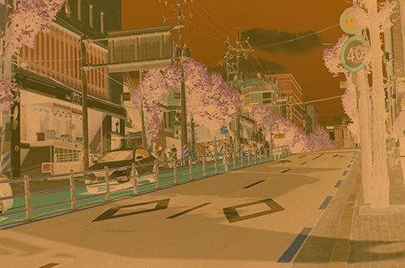
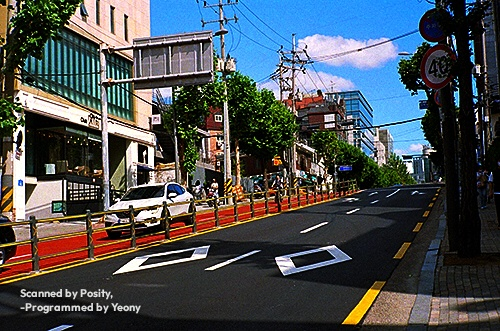
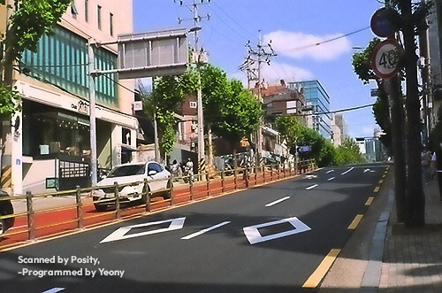
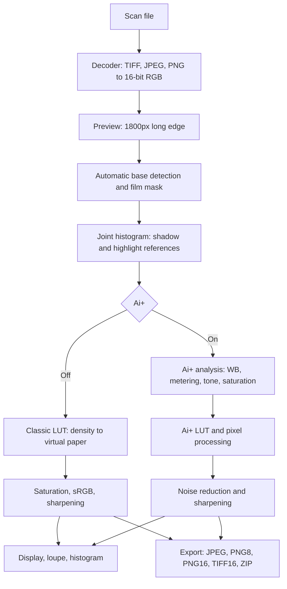
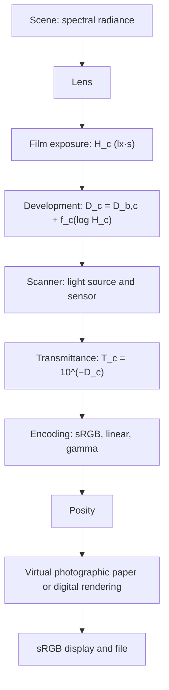

[한국어](README.md)&emsp;&emsp;English

> Please contact me personally if you have collaborated or contributed, or would like to. Personal, non-commercial use is free. However, copyright and ownership belong to the original author, collaborators and contributors; modifying this program or its source, distributing it elsewhere or selling it is not permitted. See LICENSE for the detailed terms.

# 🎞️ Posity

Use by DC Inside users is prohibited under the author's license notice, which states that the restriction has legal effect.
The notice states that violations will lead to comparison with IP information on DC Inside and a criminal complaint.
See LICENSE for this provision.

A single-file tool that turns color-negative film scans into positive photographs directly in your browser.
There is nothing to install and nowhere to upload your images. Just open `posity.html` in a browser.

<https://scan.yeon.at/posity.html>

Current version **v2.12.0** · See [12. Changelog](#12-changelog) for changes. A [help page](https://scan.yeon.at/information.html) also presents the usage instructions, principles and analysis information. The version appears beside the title at the upper left of the app. Through v2.8.3 the app was named “Negative Printer,” and through v2.9.0 its filename was `negative-printer.html`; the old address redirects to the new one.

**Contents**

1. [At a glance](#1-at-a-glance)
2. [Principles](#2-principles)
3. [How it works](#3-how-it-works)
4. [Algorithms and equations](#4-algorithms-and-equations)
5. [The physical world](#5-the-physical-world)
6. [Architecture](#6-architecture)
7. [Issues and fixes](#7-issues-and-fixes)
8. [Optimization](#8-optimization)
9. [Validation](#9-validation)
10. [Strengths](#10-strengths)
11. [Limitations](#11-limitations)
12. [Changelog](#12-changelog)

---

## 1. At a glance

### What is this tool?

Developing color film from a film camera produces an orange-tinted image with bright areas dark, dark areas bright, and reversed colors. This is a negative. Scanning the film brings the same inverted orange image into your computer.

Posity turns it into an ordinary positive photograph. In effect, it performs in a browser the job that a photo lab once performed by printing film onto paper.

### Benefits

- **Nothing to install.** Open one file in a browser.
- **Photos stay on your device.** All calculations take place locally, without uploads.
- **Automatic adjustment.** It estimates and corrects the film's orange cast, brightness and color balance.
- **Multiple images at once.** Load and save a batch together.
- **Fine tonal precision.** You can save files that preserve the scan's subtle tonal steps.

### How to use it

1. Open `posity.html` in a browser such as Chrome, Edge, Safari or Firefox.
2. Click **Open scans** or drag files onto the page. Add several files at once, or drop a folder to include images in its subfolders. Files already in the list are skipped.
3. Wait briefly for the positive image to appear.
4. Adjust cropping, rotation, brightness and color if needed. Select another image in the left filmstrip or use ← →. Thumbnails are converted one by one in the background after loading. Remove an unwanted frame with × at the top right of its thumbnail and restore it using **Undo** in the notification.
5. Use **Export** for the current image or **All ZIP** for the entire set. The output has a two-line “Scanned by Posity, -Programmed by Yeony” watermark near the lower left, inset from the edge; the preview shows it in the same position. If you **Cancel** All ZIP partway through, it saves only the images converted so far. Ai+ state, output format and JPEG quality are retained for the next session.

Hold N to see the original negative temporarily, and inspect detail with the 1:1 loupe.

### The Ai+ button

Ai+ finishes a film photo **like a photograph taken with a digital camera**: clearer, without a washed-out appearance, with cleaner whites, slightly fresher colors and reduced film grain. A short message below the button describes the corrections applied.

It cannot promise a good result for every photo. If you dislike the result, turn Ai+ off or return just that frame to the classic method.

### Example

This is a color-negative scan of a sunny street with cherry blossoms (500 × 331px, 8-bit JPEG). Both methods were run by simply loading the file without changing any settings (v2.11.0; the lower-left mark is the watermark).

<p align="center"></p>
<p align="center"><sub>The original negative scan. The orange film-base mask extends across the image.</sub></p>

| Classic method | Ai+ |
|:---:|:---:|
|  |  |

The **classic method** is vivid and contrasty like photographic paper. The sky is deep blue, and the red cycle lane and green trees are pronounced. However, both tonal extremes clip: sunlit asphalt and shadows become almost solid black, and parts of the white building wall blow out.

**Ai+** reports “Correction · brightness +1.7EV · saturation +39% · grain reduction.” The asphalt and pavement grays were already neutral, so it did not alter their color balance. It raised midtones that the classic method had made too dark by 1.7 stops, increased the scan's weak saturation and reduced film grain. Asphalt texture, paving in shadow and the white car's shape remain visible, while shadows are still sufficiently deep and almost none are crushed to black (classic 19%, Ai+ 1%). The sky is slightly brighter and paler blue than in the classic result.

These serve different purposes rather than one being the single correct answer. Choose classic for a strong print-like result, or Ai+ for a digital-photo-like result retaining shadow and highlight detail. Both can be refined with sliders. Raising **Black point** in Ai+ deepens shadows; raising **Exposure** by about +0.9EV in classic recovers this example's crushed shadows. Measurements appear under “Real scan example” in [9. Validation](#9-validation).

### Good to know

Including a little orange, unexposed film border in the scan helps color estimation. You can open scanner-produced TIFF, JPEG and PNG, including 16-bit PNG, and camera-captured DNG. Other camera RAW files, such as CR2, NEF and ARW, can be converted to DNG with the free Adobe DNG Converter first. Files over 200 megapixels cannot be opened because of browser memory limits. The tool works offline; only the interface font falls back to a default font.

---

### Help page

The principles, operation and analysis material in this README are also presented on a readable [help page](https://scan.yeon.at/information.html). Open it in a new tab using **Help** in the toolbar or <kbd>?</kbd>. It additionally includes interface orientation, shortcuts, troubleshooting, a glossary and references.

- [Part 1: Getting started](https://scan.yeon.at/information.html#part-1) — first-use workflow, interface, Ai+ correction messages, shortcuts, saving, watermarks and troubleshooting.
- [Part 2: Principles](https://scan.yeon.at/information.html#part-2) · [Part 3: How it works](https://scan.yeon.at/information.html#part-3).
- [Part 4: Analysis](https://scan.yeon.at/information.html#part-4) — algorithms/formulas, physical principles, system design, issues solved, optimization, validation, strengths, limitations and references.
- [Appendix: Glossary](https://scan.yeon.at/information.html#glossary).

---

## 2. Principles

### 2.1 How color-negative film records an image

Color-negative film has three photosensitive layers responding to blue, green and red light. Development forms a complementary dye—yellow, magenta or cyan—in each exposed layer, with more exposure producing denser dye. The resulting film image therefore reverses both brightness and color.

Real dyes are imperfect. Magenta should absorb only green light but also absorbs some blue, while cyan absorbs some green and blue as well as red. To compensate for this unwanted absorption, the film retains yellowish/pinkish masking couplers where less image dye forms. Mask color disappears as dye forms, so unwanted absorption plus the mask adds to **the same amount everywhere**, independent of exposure. This produces the uniform orange appearance, together with film-base and development-fog density.

### 2.2 Density and the characteristic curve

Transmittance $`T`$ expresses how much light passes through the film, and density $`D = -\log_{10} T`$ expresses how much it blocks. Because density is logarithmic, multiplication becomes addition. Stacking two film layers adds their densities, and doubling exposure increases density by a certain amount.

The relation between density and log exposure is the characteristic, or H&D, curve. Its middle is approximately linear, with flattened toe and shoulder at the ends. The linear slope is gamma $`\gamma`$, typically around 0.6 for a color negative. Making a scene one stop—twice—as bright increases density by $`0.6 \times \log_{10} 2 \approx 0.18`$. The tool therefore performs its calculations in **density, or logarithmic space**. Exposure differences become offsets, and a uniform orange mask becomes an additive channel constant removable by subtraction.

### 2.3 Removing orange and inverting

Let $`T_b`$ be the transmittance of unexposed film, or base. Dividing each image point by $`T_b`$ gives $`T/T_b`$, removing mask, base and fog and leaving the image-density component. The common practice of inverting colors and then subtracting orange approximates this division using gamma-encoded values or linear inversion, leaving brightness-dependent color errors. This tool first restores scan values to linear transmittance, then performs the division.

### 2.4 Balancing the three channels

The three layers have slightly different gammas, and scanner illumination and sensors also differ by channel. The same scene range is therefore recorded as different density ranges. The tool finds thin-image regions as shadow references and dense regions as highlight references, then normalizes each channel's density range to 0–1.

Reference selection makes **all three channels use the same groups of pixels**. Independently choosing channel extremes could mix, for example, dense blue sky with a dense white wall, introducing a color error in the reference itself. Per-channel normalization compensates for layer-gamma differences this way; linked normalization uses a common range across channels to retain the film's inherent color character.

### 2.5 Virtual photographic paper: the classic method

Optical printing projects a negative onto photographic paper, which has its own S-shaped characteristic curve and maximum density. Classic mode models that paper. Applying its curve to normalized log exposure gives reflectance, so the exposure, temperature and tint sliders shift log exposure like enlarger exposure time and color filters. The result resembles a photograph printed from film onto paper.

### 2.6 Ai+: digital-camera rendering instead of paper

Ai+ retains the film interpretation in 2.3 and 2.4, replacing only the final paper stage with **digital-camera-style rendering**. A per-channel paper curve pushes bright colors, such as sky, toward the shoulder in all three channels, washing them out, while separating shadow channels too strongly and making their colors overly dense. A digital camera applies a luminance curve while preserving color ratios.

Ai+ combines six ideas: **white balance** that estimates and subtracts residual casts in neutral candidates at different brightness levels; **metering** that adjusts representative scene brightness; an **S-shaped luminance tone curve**; **vibrance and saturation leveling** that give weaker colors more support; **clarity** that increases medium-scale contrast and reduces grain; and **sharpening** that emphasizes edges stronger than noise. These are image-statistics calculations rather than a neural network, and all run inside the browser.

---

## 3. How it works

### 3.1 Overall flow



### 3.2 Loading files

TIFF files use a custom decoder supporting 8- and 16-bit integers and 32-bit floating point, uncompressed/LZW/Deflate/PackBits data, strips and tiles, and chunky and planar layouts. A custom decoder preserves 16-bit PNG data (falling back to the browser's 8-bit decoder if decoding fails). JPEG and 8-bit PNG use the browser decoder and therefore have 8-bit precision. The custom DNG decoder reads raw data, demosaics a 2×2 Bayer pattern, and selects linear encoding. TIFF/PNG ICC profiles or gAMA information automatically select the appropriate scan encoding. All inputs are standardized to arrays of 16-bit integers per channel.

```math
v = 257\,v_8\ \ (\text{8-bit}),\qquad
v = \big\lfloor 65535\ \mathrm{clip}(f, 0, 1) + 0.5 \big\rfloor\ \ (\text{32-bit float})
```

Eight-bit values are expanded so that 0 becomes 0 and 255 becomes 65535. TIFF horizontal differencing (Predictor 2) is reversed with $`v_i \leftarrow (v_i + v_{i-n}) \bmod 2^{b}`$, where $`n`$ is the number of samples per pixel and $`b`$ the sample bit depth. WhiteIsZero grayscale, where 0 represents white, is inverted with $`v \leftarrow 65535 - v`$; grayscale values are copied to all three channels.

A separate preview with a long edge of 1800px is used for analysis and display. Full-resolution calculations run only for the 1:1 loupe and export. Downsampling uses area averaging. For an original $`W \times H`$, let $`k = \max(W, H)/1800`$ (no reduction if $`k \le 1`$), $`w = \mathrm{round}(W/k)`$, and $`h = \mathrm{round}(H/k)`$. Each preview cell averages the original block it covers.

```math
\bar v(x, y) = \left\lfloor \frac{1}{\lvert A_{xy}\rvert} \sum_{(i, j) \in A_{xy}} v(i, j) + 0.5 \right\rfloor,\qquad
A_{xy} = \left[\left\lfloor \tfrac{xW}{w} \right\rfloor,\ \left\lfloor \tfrac{(x+1)W}{w} \right\rfloor\right) \times \left[\left\lfloor \tfrac{yH}{h} \right\rfloor,\ \left\lfloor \tfrac{(y+1)H}{h} \right\rfloor\right)
```

Each block is at least one pixel wide and high. Originals up to 200 megapixels are accepted: approximately 1.2GB as 16-bit RGB. Larger images exceed the browser's memory limit.

### 3.3 Finding the film and its base

**Automatic base detection** averages the brightest 0.3% (at least 50) of pixels satisfying the orange-channel order $`R \ge G \ge B`$, because unexposed film transmits the most light. Scanner-clipped values (codes at or above 98.5%) are excluded. If fewer than the larger of 500 pixels or 2% of all pixels satisfy the orange condition, detection retries without that color condition.

The “brightest 0.3%” are selected in groups of 64 code values. For $`n`$ candidate pixels, the three-channel mean code $`\bar v_i = (R_i + G_i + B_i)/3`$ is assigned to bin $`b_i = \lfloor \bar v_i / 64 \rfloor`$ (1,024 bins). Counts accumulate from the brightest bin until first reaching $`N^* = \max(50,\ 0.003\,n)`$, defining bin $`b^*`$. The base is the per-channel mean code of pixels with $`b_i \ge b^*`$. Its transmittance is obtained by rounding that code and applying the same decoding function ($`\mathrm{dec}`$) as for scan values.

```math
\bar v^{\,b}_c = \frac{1}{\lvert \mathcal B\rvert} \sum_{i \in \mathcal B} v_{c,i},\qquad
\mathcal B = \{\, i : b_i \ge b^* \,\},\qquad
T_{b,c} = \mathrm{dec}\!\left(\frac{\mathrm{round}(\bar v^{\,b}_c)}{65535}\right)
```

The **film-area mask** classifies pixels into three groups by density relative to the base.

| Class | Condition | Meaning |
|---|---|---|
| Outside film | Clipped, average density at least 2.4 above the base, or all three channels at least 0.03 thinner than the base | Holder, mask, gaps between film, and light leaking through perforations |
| Base-like | All three channels within ±0.1 of the base | Inter-frame margins (used for automatic fitting and Ai+ statistics) |
| Image | Everything else | Pixels used for statistics |

Film boundaries found in the mask narrow the statistical region and support automatic crop fitting. The “analysis exclusion border” (3% by default) removes an additional margin inside it.

Boundary detection walks inward one row or column at a time. A row at the top/bottom or column at the left/right is treated as border while its outside-film fraction is at least 0.6, up to 30% of the image dimension on each side. It then removes up to another 5% of rows/columns with a fraction of at least 0.15 to clear angled holder wedges. Detected sides move inward another $`k = \max\big(3,\ \mathrm{round}(0.004 \max(W, H))\big)`$ pixels to avoid boundary blur. If the remaining width or height is at most 20% of the image, boundary detection is considered unsuccessful. Automatic fitting performs the same procedure using both outside-film and base-like pixels as border, with thresholds of 0.6 and 0.3.

The analysis area is the intersection of the film interior and the crop rectangle $`(x, y, w, h)`$ reduced by margin fraction $`m`$. If the intersection is smaller than 5% of the reduced rectangle, only the reduced rectangle is used.

```math
\big[x + m w,\ x + (1 - m) w\big] \times \big[y + m h,\ y + (1 - m) h\big]
```

### 3.4 Finding shadow and highlight references

To prevent a single grain from setting an extreme, a **rank map** first averages the image pixels' three-channel mean log transmittance over a 5×5 neighborhood. Those ranks populate a **joint histogram** spanning log transmittance −6 to 0 at intervals of $`1/1024`$ (6,144 bins). Each bin also accumulates the sums of linear transmittance for all three channels.

```math
\bar\lambda_i = \frac{1}{3} \sum_c \log_{10} T_{c,i},\qquad
\rho_i = \frac{\sum_{j \in N_5(i)} m_j\, \bar\lambda_j}{\sum_{j \in N_5(i)} m_j},\qquad
q_i = \mathrm{clip}\big(\lfloor 1024\,(\rho_i + 6) \rfloor,\ 0,\ 6143\big)
```

$`N_5(i)`$ is a 5×5 neighborhood (edge values are extended beyond the image). $`m_j`$ is 1 for a film pixel and 0 for an outside-film or dark-clipped pixel. If the neighborhood contains no film pixels, the pixel's own $`\bar\lambda_i`$ is used. Let $`n_q`$ be the pixel count in bin $`q`$ and $`\Sigma_{q,c}`$ its sum of linear transmittance.

The required pixel count is collected from the thinnest tail (shadow clipping, 0.1% by default) and densest tail (highlight clipping, 0.1% by default); only the required fraction of the final bin is included. The per-channel average transmittances of these groups become the shadow and highlight references. Tail fraction $`p`$ is never smaller than 0.02%.

```math
N^* = \max\!\big(1,\ n \cdot \max(p,\ 0.02\%)\big),\qquad
f_q = \mathrm{clip}\!\left(\frac{N^* - \sum_{q' \text{ earlier}} f_{q'}\, n_{q'}}{n_q},\ 0,\ 1\right),\qquad
\bar T_c = \frac{\sum_q f_q\, \Sigma_{q,c}}{\sum_q f_q\, n_q}
```

Bins are visited in order from the end of the relevant tail; “earlier” means bins already visited. The logarithm of the average transmittance is floored at $`-6`$. If the two references are too close, the thin reference is raised to satisfy $`\log_{10} \bar T^{\,\mathrm{thin}}_c \ge \log_{10} \bar T^{\,\mathrm{dense}}_c + 0.01`$. If excluding non-film pixels leaves fewer than 5% (for example, after a mistaken base detection), statistics are recalculated without exclusion.

Channels clipped at the dark end during scanning are handled separately. The orange mask commonly pushes the blue channel of an 8-bit scan (sometimes green or red as well) onto the floor, codes 0–2; these pixels' actual densities are unknown. If floor-valued pixels exceed 0.5% of a channel within the film area, excluding non-film areas such as the black holder border, that channel is considered clipped. Those pixels are excluded from reference statistics and Ai+ analysis, and the LUT maps the floor to the first unclipped value. Opening the image displays a notification identifying the clipped channels and their percentages. Smaller amounts of clipping are left alone because they barely affect the reference tails.

### 3.5 Lookup tables (LUTs)

Each slider adjustment rebuilds a 65,536-entry lookup table for each channel. The index is the 16-bit scan value and the entry is its final linear output. Pixel processing requires only one lookup per channel and a few multiplications, making sliders immediately responsive.

### 3.6 Finishing and saving

The classic method applies luminance-preserving saturation to the linear values from the LUT, encodes them as sRGB, and applies a luminance-only unsharp mask (default amount 50%, original-resolution radius 1.0px, noise threshold 1%). In the preview, the radius scales with display magnification; sharpening is skipped below 0.35px.

Export processes bands of 128 rows. Each band includes extra surrounding pixels that are cropped afterward, so neighborhood-based sharpening and noise reduction match a single uninterrupted pass without seams at band boundaries. The available formats are:

| Format | Method |
|---|---|
| JPEG (8-bit) | Canvas encoder; quality 92 / 95 (default) / 100 |
| PNG (8-bit) | Canvas encoder |
| PNG (16-bit) | Custom encoder (`CompressionStream` Deflate, Up filter on each row, IDAT chunks of about 1MB). Includes an sRGB chunk, gAMA ($`\gamma = 1/2.2`$) and cHRM (D65, sRGB primaries) for programs that do not understand it, 300dpi resolution (pHYs), software identification, and save time (tIME). Pixel values match 16-bit TIFF |
| TIFF (16-bit) | Custom encoder. Same 16-bit values as PNG16, Deflate compression, horizontal differencing, and an sRGB ICC profile |
| All frames as ZIP | Custom ZIP writer (uncompressed storage), split at 1.8GB. Cancellation finishes the current frame and saves the ZIP accumulated so far |

For encoded value $`c''`$ (0–1), output quantization is $`\mathrm{round}(255\,c'')`$ for 8-bit (ties to even, matching canvas) and $`\lfloor 65535\,c'' + 0.5 \rfloor`$ for 16-bit. The onscreen preview uses the same 8-bit rule.

**Watermark.** Every saved result (JPEG, PNG8, PNG16, TIFF16, and all-frame ZIP) carries two lines at the lower left:

```
Scanned by Posity,
-Programmed by Yeony
```

The watermark is applied after cropping and rotation, so this tool's crop cannot remove it. It is inset by 6% of the short edge; cropping it away in another program also sacrifices part of the photo's edge. If a film holder or margin surrounds the image, placement uses the lower-left corner of the detected photo area. Adding a solid black, white, or base-colored margin therefore leaves the watermark inside the photo. Text size is 2.5% of the short edge (minimum 11px), line spacing is 1.25 times the text size, and white text at 85% opacity has a subtle black shadow for readability over both light and dark areas. The font is Outfit bold (700), matching the Posity header. Glyph shapes are embedded in the tool, independent of network access or installed fonts. Text and shadow are rasterized without the browser's text renderer, producing pixel-identical watermarks across devices and browsers. Eight- and 16-bit exports use the same watermark. Onscreen it appears at the same relative size in the lower-left corner of the export area (the crop rectangle while cropping), and disappears during original view or base picking. It is omitted from filmstrip thumbnails and the 1:1 loupe.

**Invisible mark.** A repeating pattern too faint to see (±1–2 levels) is added to the saved image's luminance. The watermark text determines the pattern, and the same signature is stored in file metadata (JPEG comments and PNG tEXt). Equal changes to all three channels preserve color; the pattern is omitted from the preview. This is a lightweight attribution mark, not strong protection. Resaving or substantial editing can remove it, and the metadata signature is easy to erase.

Files are named `originalname_positive.jpg`, or `originalname_positive_ai.jpg` for frames processed with Ai+. ZIP output is `positives.zip`, or `positives_1.zip`, `positives_2.zip`, … when split. Files are saved through the browser's normal download mechanism.

### 3.7 Editing tools

| Tool | Behavior |
|---|---|
| ↺ 90° / ↻ 90° / Flip horizontally | Change orientation |
| Crop | Drag handles on edges/corners or drag inside to move. Ratios: free, 3:2 (135, 6×9), 4:3 (6×4.5), 1:1 (6×6), 5:4 (6×7), 65:24 (panorama). Automatic fitting centers the selected ratio inside the film boundary |
| Pick base | Sets the base from a 7×7 average around the selected point and changes the black reference to “Film base” (with Ai+ enabled, only the base is used; the black reference remains fixed to Auto) |
| Pick gray | Calculates temperature and tint that make the selected 5×5 area neutral |
| Original view | Shows the original scan while the button or N key is held (also the same key on a Korean keyboard) |
| 1:1 loupe | A 220×220px area processed at original resolution |
| Histogram | Eight-bit RGB distribution of the crop result. Each channel has 256 bins, with height $`\min\!\big(1, \sqrt{h_b / h_{\max}}\big)`$, where $`h_{\max}`$ is the highest bin excluding both endpoints. A white triangle appears at the corresponding corner if more than 0.2% accumulate at 0 or 255 |
| Reset corrections | Restores correction defaults; preserves crop, rotation, flip, and the Ai+ exception |
| Apply to all frames | Copies settings except crop, rotation, flip, and the Ai+ exception to every frame and immediately regenerates their thumbnails |
| Remove from list | The × on a filmstrip thumbnail (visible on hover, always visible on touch devices). Retains the frame and its settings for restoration to its original position with “Undo” in the notification. Removed frames are excluded from the all-frame ZIP |

To fit crop ratio $`R`$, use $`\rho = R`$ for a landscape box and $`\rho = 1/R`$ for a portrait box. Within a $`w \times h`$ box, center $`w' = \min(w,\ h\rho)`$, $`h' = w'/\rho`$. Changing the ratio preserves the current box's center and shrinks the whole box if it would extend outside the image.

Settings are stored per frame. If any frame has been edited, the browser asks for confirmation before reloading or closing. Keyboard controls are ← → or PageUp/PageDown for the previous/next frame, Home/End for the first/last frame, Esc to leave a tool, and Enter to finish cropping. When a slider has focus, ← → adjusts its value. Unreadable filmstrip files are labeled “Cannot read,” with the reason shown on hover. Input choices and sliders are:

| Setting | Choices or range | Default |
|---|---|---|
| Scan encoding | sRGB gamma / Linear (linear TIFF extracted from RAW, DNG) / Gamma 2.2 / Gamma 1.8 / File tone curve | Automatic from file information (ICC profile, PNG color information, DNG); otherwise sRGB |
| Black reference | Auto (shadow percentile) / Film base (unexposed = black) | Auto |
| Channel normalization | Per-channel (corrects layer gamma differences) / Linked (preserves the film's own color response) | Per-channel |
| Exposure | −3 … +3 EV | 0 |
| Contrast | 0.5 … 2× | 1 |
| Black point / White point | −20 … +30% / −30 … +20% | 0 |
| Temperature / Tint | −2 … +2 (per-channel print-exposure stops) | 0 |
| Saturation | 0 … 200% | 100% |
| Sharpness: Amount / Radius / Noise threshold | 0 … 300% / 0.4 … 4px / 0 … 5% | 50% / 1.0px / 1% |
| Shadow/highlight clipping | 0 … 2% | 0.1% |
| Analysis exclusion border | 0 … 20% | 3% |

### 3.8 With Ai+ enabled

Ai+ analyzes a frame once when opened or when analysis settings change (about 0.4–0.5 seconds for a large scan), then builds its LUT from the results. The sequence is:

1. Set the classic method to neutral slider values. Lock the black reference and channel normalization to the recommended Auto and Per-channel settings; disable those two controls.
2. Convert normalized log exposure to linear light to create an **analysis map** with a long edge of 768px. Reuse it while the film area and analysis settings remain unchanged; otherwise rebuild it.
3. Select film pixels inside the crop and exclusion border for statistics. Exclude base pixels such as inter-frame margins, except when they make up most of a scene, as in night photography.
4. Compute white balance (a brightness-dependent cast agreed upon by neutral candidates from each brightness range), metering, the tone curve, saturation targets, and the local-contrast map, in that order.
5. On the first render, measure grain in five full-resolution 256×256 blocks: the center and the centers of the four quadrants.
6. Apply tone, color, and local contrast per pixel, then noise reduction and sharpening at original resolution (or for previews at least 0.6× scale).

With Ai+ enabled, tone/color sliders become **fine adjustments added to the Ai+ result**. All zeros leave the Ai+ result unchanged. In a panel explanation such as “WB correction (equivalent to temperature −0.22, tint +0.08),” the parenthesized values express the removed mid-brightness cast in temperature/tint slider units. If white balance overcorrects a beige wall under fluorescent light, moving the sliders by the opposite amounts restores it.

| Slider | Meaning in Ai+ |
|---|---|
| Exposure | Shifts brightness in stops before the tone curve |
| Contrast | Multiplies both curve slopes |
| Black point | Shadow depth. Multiplies only the below-key slope by $`2^{1.5 p_b}`$ on the positive side or $`2^{2.5 p_b}`$ on the negative side, blending smoothly to 1 near the key. Mid-brightness and white remain unchanged |
| White point | Curve ceiling $`W = 1 - 0.5 \times \text{value}`$ (0.85…1.25) |
| Temperature / Tint | Per-channel log offsets after Ai+ white balance |
| Saturation | Multiplies the saturation factor selected by Ai+ |
| Sharpness | Amount ×1.5; the threshold is automatically raised to match remaining grain |

The explanation below the button lists only actions actually taken: **WB correction** (retaining some warmth), **Brightness ±xEV** (relative to classic brightness at the same measurement point), **Preserve bright scene / Preserve dark scene** (following the scene key), **Dehaze**, **Dynamic-range compression**, **Saturation ±x%**, and **Grain reduced**. Checking “Use the classic method for this frame only” disables Ai+ for that frame.

---

## 4. Algorithms and equations

In the notation below, $`c \in \{R, G, B\}`$ denotes the channel, and the luminance weights are $`w = (0.2126,\ 0.7152,\ 0.0722)`$ (sRGB/Rec.709).

### 4.1 Scan values → transmittance

The 16-bit code $`v`$ is converted back to linear transmittance.

```math
T = \mathrm{dec}\!\left(\frac{v}{65535}\right),\qquad
\mathrm{dec}_{\mathrm{sRGB}}(u) =
\begin{cases}
u / 12.92 & u \le 0.04045 \\[2pt]
\left(\dfrac{u + 0.055}{1.055}\right)^{2.4} & \text{otherwise}
\end{cases}
```

For linear encoding, $`\mathrm{dec}(u) = u`$; for gamma 2.2, $`\mathrm{dec}(u) = u^{2.2}`$. Log transmittance $`\log_{10} T`$ is precomputed in a 65,536-entry table. $`T`$ is floored at $`10^{-6}`$, so $`\log_{10} T \ge -6`$. For channels clipped at the dark end, the log transmittance of floor values $`v \le 514`$ (8-bit codes 0–2) is replaced by $`\log_{10} T(515)`$.

### 4.2 Classic method

**Density relative to the base.** $`T_{b,c}`$ is base transmittance.

```math
D_c = \log_{10} T_{b,c} - \log_{10} T_c
```

**Reference densities.** Let the per-channel mean transmittances of the tail groups from 3.4 be $`\bar T^{\,\mathrm{dense}}_c`$ for the densest end and $`\bar T^{\,\mathrm{thin}}_c`$ for the thinnest end.

```math
D^{\mathrm{hi}}_c = \log_{10} T_{b,c} - \log_{10} \bar T^{\,\mathrm{dense}}_c,\qquad
D^{\mathrm{lo}}_c =
\begin{cases}
\log_{10} T_{b,c} - \log_{10} \bar T^{\,\mathrm{thin}}_c & \text{Auto} \\
0 & \text{Film base}
\end{cases}
```

```math
r_c = \max\!\left(D^{\mathrm{hi}}_c - D^{\mathrm{lo}}_c,\ 0.05\right),\qquad
r_c \leftarrow \tfrac{1}{3}\textstyle\sum_k r_k\ \ (\text{Linked})
```

**Scene range (stops).** Film gamma is assumed to be $`\gamma_{\mathrm{film}} = 0.6`$. This is used only to convert EV units.

```math
S = \frac{r_G}{\gamma_{\mathrm{film}} \log_{10} 2}
```

**Normalized log exposure and user controls.** For exposure $`E`$ in stops, temperature $`t`$, tint $`m`$, black point $`p_b`$, and white point $`p_w`$:

```math
x_c = \left(\frac{D_c - D^{\mathrm{lo}}_c}{r_c} + \frac{k_c + E}{S} - p_b\right)\frac{1}{1 + p_w - p_b},
\qquad
k = \left(t + \tfrac{m}{2},\ -m,\ -t + \tfrac{m}{2}\right)
```

The temperature axis $`(1, 0, -1)`$ and tint axis $`(\tfrac12, -1, \tfrac12)`$ are both orthogonal to $`(1,1,1)`$, so changing color does not change overall brightness.

**Virtual photographic paper.** Maximum density is $`D_{\max} = 2.4`$, slope is $`g = 5 \times \text{contrast}`$, and the center is $`x_0 = 0.5`$.

```math
D_p(x) = \frac{D_{\max}}{1 + e^{\,g (x - x_0)}},\qquad
R(x) = 10^{-D_p(x)},\qquad
y_c = \max\!\left(0,\ \frac{R(x_c) - R(0)}{R(1) - R(0)}\right)
```

The midpoint slope is $`D_{\max}\, g / 4 = 3.0`$ (density per normalized unit). For an 8-stop scene range, this is approximately 0.38 density per stop; the overall gamma in reflectance is approximately 1.25, similar to the contrast of a real print.

**Saturation (luminance-preserving) and encoding.** $`s = \text{saturation} \times 1.1`$.

```math
Y = \sum_c w_c\, y_c,\qquad y'_c = Y + s\,(y_c - Y)
```

Values are clipped to $`[0,1]`$ and then sRGB-encoded. Encoding uses a 65,536-entry table with 16-bit precision.

```math
\mathrm{enc}(y) =
\begin{cases}
12.92\,y & y \le 0.0031308 \\[2pt]
1.055\,y^{1/2.4} - 0.055 & \text{otherwise}
\end{cases},\qquad
c' = \mathrm{enc}\!\left(\frac{\lfloor 65535\, y'_c + 0.5 \rfloor}{65535}\right)
```

**Sharpening (unsharp mask with a soft threshold).** $`Y' = \sum_c w_c\, c'_c`$ is luminance calculated with the same weights from encoded values; $`G_\sigma`$ is a Gaussian, $`a`$ is the amount, and $`\theta`$ is the noise threshold.

```math
d = Y' - G_\sigma * Y',\qquad
d' = a\, d\, \min\!\left(1, \frac{\lvert d\rvert}{\theta}\right),\qquad
c'' = \mathrm{clip}(c' + d',\ 0,\ 1)
```

Small variations with $`\lvert d\rvert < \theta`$ are boosted only weakly by $`a\,d\lvert d\rvert/\theta`$, preventing harsh grain. The Gaussian is separable, $`G_\sigma(i) \propto e^{-i^2/2\sigma^2}`$, truncated at radius $`r = \max(1, \lceil 3\sigma \rceil)`$ and normalized to sum to 1. Values outside the image are supplied by extending the edge pixels. $`\sigma`$ is the radius slider multiplied by the display scale (preview width / original width; 1 for saving and the loupe).

**Gray eyedropper.** For log exposure in stops $`\ell_c`$ in the sampled 5×5 area, before user color correction:

```math
o_c = \bar\ell - \ell_c,\qquad
t = \frac{o_R - o_B}{2},\qquad
m = \frac{\tfrac12 o_R - o_G + \tfrac12 o_B}{1.5}
```

$`t, m`$ are clipped to the slider range $`[-2, 2]`$. With Ai+ enabled, log brightness after white balance, $`\tilde\ell_c`$, is used instead of $`\ell_c`$.

### 4.3 Ai+

**① Linear light.** Normalized log exposure from the classic method with neutral sliders is converted to linear light. The highlight reference is 1 and the shadow reference is $`2^{-S}`$.

```math
x_c = \frac{D_c - D^{\mathrm{lo}}_c}{r_c},\qquad e_c = 2^{\,S (x_c - 1)}
```

Per-channel normalization gives all three channels the same range in stops, so they all use the same $`S`$. This is equivalent to estimating and reversing each layer's gamma as $`\gamma_c = r_c / (S \log_{10} 2)`$.

Analysis uses a map downscaled to 768 px on its long side. Using the same cell division as the reduced image ($`k = \max(1, \max(W, H)/768)`$), $`e_c`$ is area-averaged in each cell. Only film pixels are averaged, or all pixels if the cell contains no film pixels. The cell's film fraction $`V`$ and base-like fraction $`B_f`$ are recorded as well. Statistics use cells inside the analysis area with $`V > 0.6`$; if fewer than 400 qualify, all cells in the area are used. Cells with $`B_f \ge 0.5`$ are excluded unless doing so would leave fewer than 40% of the cells. If fewer than 64 cells remain, Ai+ analysis is skipped and rendering uses the classic method.

**② Log values and chromaticity.**

```math
\ell_c = \log_2(e_c + \varepsilon),\ \ \varepsilon = 5\times10^{-4},\qquad
\tau = \frac{\ell_R - \ell_B}{2},\qquad
\mu = \frac{\ell_R + \ell_B}{2} - \ell_G
```

$`\tau`$ is the amber–blue axis and $`\mu`$ the magenta–green axis, both in stops. Log luminance is $`L_i = \log_2 \max(Y_i, 10^{-5})`$. Quantile $`q_p`$ is the center of the first bin where the cumulative fraction reaches $`p`$ in a histogram spanning −17…3 stops in 4,000 bins of 0.005 stop each.

**③ Neutral candidates.** Global statistics such as bright pixels, gray world, and gray edge cannot estimate white balance here. All three are dominated by the brightest linear values, which the classic method's per-channel normalization has already forced to neutral (the densest 0.1%). Their estimates therefore always remain near 0 (Section 7). Instead, the algorithm finds likely neutral regions within each brightness interval. It measures chromaticity $`(\tau_i, \mu_i)`$ and luminance $`L_i`$ from 3×3-averaged log values and divides $`[q_{1}, q_{99}]`$ into $`K`$ intervals, 0.75 stop wide (4–10 intervals). Pixel weights are:

```math
w_i = \exp\!\left(-\frac{\tau_i^2}{2\cdot 0.18^2} - \frac{\mu_i^2}{2\cdot 0.12^2}\right)\cdot
\big(0.7 + 0.3\min(1, t_i / 0.04)\big)
```

$`t_i`$ is the difference between 3×3-averaged and 9×9-averaged luminance (texture), giving slightly less weight to smooth surfaces such as sky. The interval index is defined below; pixels outside the range are not counted.

```math
k_i = \left\lfloor K\,\frac{L_i - q_1}{\Delta} \right\rfloor,\qquad
\Delta = \max(q_{99} - q_1,\ 1),\qquad
K = \mathrm{clip}\big(\mathrm{round}(\Delta / 0.75),\ 4,\ 10\big)
```

The chromaticity grid divides $`\tau \in [-0.55, 0.55]`$ and $`\mu \in [-0.4, 0.4]`$ into 0.015-stop increments, assigning each pixel to the nearest bin. Each interval accumulates $`w_i`$ on this grid, but within each 16 px map cell, at most 24 pixels count toward a single chromaticity bin. This prevents large areas of one color—sky, trees, or grass—from dominating the table. The grid is blurred twice horizontally and vertically with the binomial kernel $`[1, 4, 6, 4, 1]/16`$ (zero outside the grid), and a peak is found excluding the outer two bins. The weighted mean within a ±0.045-stop window around the peak becomes the interval's candidate $`(\tau_k, \mu_k)`$. Interval confidence is:

```math
c_k = \min\!\left(1, \frac{n^{\mathrm{cell}}_k}{8}\right)\cdot
\mathrm{clip}\left(\frac{d_k - 0.08}{0.32}, 0, 1\right)\cdot
\exp\!\left(-\frac{1}{4}\left(\frac{\tau_k^2}{2\cdot 0.18^2} + \frac{\mu_k^2}{2\cdot 0.12^2}\right)\right)
```

Here, $`n^{\mathrm{cell}}_k`$ is the number of cells with at least four pixels inside the window (candidate spatial spread), and $`d_k`$ is the fraction of the interval's weighted mass inside the window (candidate share). The final term is a prior that gives less trust to candidates far from 0, which may represent a large chromatic surface.

**④ Agreement between intervals.** Interval values are fitted as a function of brightness. Let $`z_k \in [-\tfrac12, \tfrac12]`$ be the interval position:

```math
c(z) = p_0 + p_b\,(1 - 4z^2)
```

Only a constant and a middle bend are included. The bend captures crossover: different characteristic-curve shapes between film layers can tint only the midtones even when both ends align. A slope term is deliberately omitted. The classic method has already neutralized both ends, so candidates there, such as sky and lamps, often reflect object color rather than a cast. Allowing a slope shifted the bright end of clean scenes by ±5 b* (Section 7). For the same reason, interval weights are multiplied by $`1 - \lvert 2z\rvert^{p}`$ to reduce the influence of both ends ($`p = 6`$ on the dark side and $`p = 2`$ on the bright side, which is more often occupied by light sources and sky). Fitting uses six iterations of Tukey biweight IRLS with a 0.3-stop scale, rejecting intervals far from the others. Ridge regularization equal to 1% of the total evidence is added to the bend term. Each axis, τ and μ, is solved separately.

```math
\min_{p_0,\,p_b}\ \sum_k w_k \big(y_k - p_0 - p_b B_k\big)^2 + \lambda\, p_b^2,\qquad
B_k = 1 - 4 z_k^2,\quad z_k = \frac{k + 0.5}{K} - 0.5,\quad \lambda = 0.01 \sum_k w_k
```

```math
w^{(0)}_k = c_k \big(1 - \lvert 2 z_k\rvert^{p}\big),\qquad
w_k \leftarrow w^{(0)}_k \big(1 - \rho_k^2\big)_+^2,\quad \rho_k = \frac{y_k - p_0 - p_b B_k}{0.3}
```

Intervals with confidence $`c_k \le 0.03`$ are excluded. If fewer than three usable intervals remain, only a constant is fitted, with no bend ($`p_b = 0`$). Below, rms is the root-mean-square residual under the final weights, $`\sqrt{\sum_k w_k r_k^2 / \sum_k w_k}`$, where $`r_k = y_k - p_0 - p_b B_k`$.

Evidence $`E = \sum_k w^{\mathrm{fin}}_k \cdot \exp\!\big(-(\mathrm{rms}/0.1)^2\big)`$ is the sum of final weights multiplied by residual consistency; confidence is $`\min(1, E/2)`$. This is multiplied by agreement with the scene's average color. If mean log chromaticity $`g`$ among mid-brightness pixels $`[q_{10}, q_{95}]`$ points in the same direction as the candidate consensus midpoint $`c(0)`$ and has at least half its magnitude, agreement is 1; if it points in the opposite direction, agreement is 0. This safeguard reduces correction when trees or grass dominate the candidates but the whole scene does not share their color direction.

```math
s = \mathrm{clip}\!\left(\frac{E}{2},\ 0,\ 1\right) \cdot \mathrm{agree}\big(g,\ p_0 + p_b\big),\qquad
\mathrm{agree}(g, c) =
\begin{cases}
1 & \lvert c\rvert < 0.02 \\
0 & g\,c \le 0 \\
\min\!\left(1,\ \dfrac{g}{0.5\,c}\right) & \text{otherwise}
\end{cases}
```

The constant term receives a 0.03-stop soft threshold, $`p_0 \leftarrow \mathrm{sign}(p_0) \max(\lvert p_0\rvert - 0.03,\ 0)`$, as a safeguard against overcorrecting large surfaces slightly different from reference gray. Denote the confidence-scaled values by $`\tau(z) = s_\tau \big(p^\tau_0 + p^\tau_b B(z)\big)`$ and $`\mu(z) = s_\mu \big(p^\mu_0 + p^\mu_b B(z)\big)`$. The agreement test for $`s`$ uses $`p_0`$ before thresholding. If the midpoint $`\tau_{\mathrm{mid}} = \mathrm{clip}\big(\tau(0),\ \pm 0.5\big)`$ is warm, part of that warmth is retained.

```math
a =
\begin{cases}
\min\!\big(0.4,\ 0.4\,(\tau_{\mathrm{mid}} - 0.2)\big) & \tau_{\mathrm{mid}} > 0.2 \\
-\min\!\big(0.1,\ 0.1\,(-\tau_{\mathrm{mid}} - 0.2)\big) & \tau_{\mathrm{mid}} < -0.2 \\
0 & \text{otherwise}
\end{cases}
```

```math
o(z) = \left(\tau' + \tfrac{\mu'}{3},\ -\tfrac{2\mu'}{3},\ -\tau' + \tfrac{\mu'}{3}\right),\quad \tau' = \mathrm{clip}\big(\tau(z) - a,\ \pm 0.5\big),\quad \mu' = \mathrm{clip}\big(\mu(z),\ \pm 0.35\big),
\qquad \tilde\ell_c = \ell_c - o_c\!\left(\frac{\ell_c - m}{s}\right)
```

$`m, s`$ are the midpoint and width ($`\Delta`$) of $`[q_1, q_{99}]`$. Corrections are stored in a table dividing $`z \in [-\tfrac12, \tfrac12]`$ into 1,024 bins, using the nearest bin and the endpoint bins outside the range. Each channel LUT looks up the correction using that channel's own log value. This is exact for neutral colors, where all three channels have equal log values. Chromatic colors receive corrections at slightly different brightnesses per channel, but the smooth function keeps these differences small.

**⑤ Metering and scene key.** For log luminance $`L_i = \log_2 \sum_c w_c 2^{\tilde\ell_{c,i}}`$, let the quantiles be $`l_{lo} = q_{0.5}`$ and $`l_{hi} = q_{99.5}`$, the median be $`l_{med}`$, and $`DR = l_{hi} - l_{lo}`$.

```math
\bar\ell = \frac{\sum_i \omega_i L_i}{\sum_i \omega_i},\qquad
\omega_i = \left(0.25 + 0.75\, e^{-\frac{\Delta x_i^2}{2(0.33W)^2} - \frac{\Delta y_i^2}{2(0.33H)^2}}\right) h_i
```

```math
h_i =
\begin{cases}
\max\!\big(0.35,\ 1 - 0.3\,(L_i - l_{med} - 1)\big) & L_i > l_{med} + 1 \\
1 & \text{otherwise}
\end{cases}
```

The average uses only pixels between the 1st and 99th percentiles. The center receives more weight; regions more than one stop above the median, such as sky, receive progressively less weight per stop. $`\Delta x_i, \Delta y_i`$ are distances from the analysis area's center; $`W, H`$ are its width and height in map pixels. If no pixels are available for averaging, $`\bar\ell = (l_{lo} + l_{hi})/2`$.

```math
f = \mathrm{clip}\left(\frac{2\bar\ell - l_{lo} - l_{hi}}{\max(DR, 4)},\ -0.8,\ 0.8\right),\qquad
f_d = \mathrm{dz}(f, 0.12)
```

```math
Y_{\mathrm{key}} = \mathrm{clip}\left(0.26 \cdot 4^{\,e(f_d)},\ 0.02,\ 0.52\right),\qquad
e(f_d) =
\begin{cases}
1.15\, f_d & f_d \ge 0 \\
2.0\, f_d - 1.7\, f_d^{\,2} & f_d < 0
\end{cases}
```

Ordinary scenes with $`\lvert f\rvert \le 0.12`$ are all adjusted to the same brightness (a log mean corresponding to linear 0.26, approximately L* 58). Only clearly distinctive scenes such as snowfields or night scenes retain their key. The quadratic term on the low-key side leaves moderately dark scenes, such as indoor lighting with $`f_d \approx -0.08`$, almost unchanged, while keeping very dark scenes such as night views with $`f_d \approx -0.56`$ darker. Mean L* in the synthetic night scene fell from 32 to 24 (reference 15; classic method 14). A slight brightening bias, like a phone camera's, was retained.

**⑥ Two-slope tone curve.** The curve is defined for key-relative luminance $`u = Y / 2^{\bar\ell}`$ and $`v = \ln u`$.

```math
g(v) = \kappa\left(\ln\!\left(1 + e^{v/\kappa}\right) - \ln 2\right),\quad \kappa = 0.7
```

```math
\mathcal L(v) = \mathrm{logit}(Y_{\mathrm{key}}) + n_s\,\big(v - g(v)\big) + n_h\, g(v),\qquad
T(u) = \frac{W}{1 + e^{-\mathcal L(\ln u)}}
```

The slope is $`n_s`$ below the key and $`n_h`$ above it, joined smoothly over approximately one stop. Since $`\mathcal L`$ is linear in $`n_s, n_h`$, the two targets are solved exactly as a 2×2 linear system.

```math
\mathcal L(v_{lo}) = \mathrm{logit}(b_T),\qquad \mathcal L(v_{hi}) = \mathrm{logit}(0.95),\qquad n_s \in [1.45,\ 2.0],\quad n_h \in [1.5,\ 2.0]
```

```math
v_{lo} = (l_{lo} - \bar\ell)\ln 2,\quad v_{hi} = (l_{hi} - \bar\ell)\ln 2,\qquad
b_T = 0.004 \cdot 2^{\,0.7\,\mathrm{clip}(6 - DR,\ 0,\ 4.5)}
```

The lower bounds guarantee midtone contrast like a camera curve. Even in scenes with a very wide dynamic range, the curve does not stretch to include everything: it clips both ends. Some shadow detail in such scenes is recovered by the large-scale contrast compression in ⑩. The highlight-side upper bound is higher than the shadow-side bound because digital-camera curves steepen above the midtones and form a shoulder near white. When both upper bounds were the same (1.7), white objects in ordinary scenes with roughly 5 stops of dynamic range—white pillars darker than the sky and the white ColorChecker patch—remained light gray at L* 82–89, creating a washed-out appearance (Section 7).

$`v_{lo}`$ is constrained to at most −0.5 and $`v_{hi}`$ to at least 0.3. If the system cannot be solved because its determinant is near 0, a value of 1.5 is used. For each stop by which the dynamic range falls below 6 stops, black-point target $`b_T`$ is made shallower by a factor of $`2^{0.7}`$. This avoids forcibly stretching genuinely hazy scenes such as fog and burying shadow colors. Through v2.6, the threshold was 8 stops. In real negatives, however, the film toe—the low-exposure region where density barely increases—and scanning compress the shadows, so even clear daylight scenes measure only a little over 5 stops. This left real-scan shadows raised to L* 12 and looking pale (Section 9, “Real scan examples”), so the threshold was reduced to 6 stops. Synthetic scenes have almost no toe and did not reveal this difference. If one slope exceeds its range, it is clamped and the other slope is refitted to its own target.

The contrast slider multiplies $`n_s, n_h`$, while black-point slider $`p_b`$ applies multiplier $`b_f`$ only to the shadow-side term. Near the key, the multiplier transitions smoothly to 1 through $`\sigma(-v/\kappa)`$, leaving the key ($`v = 0`$) unchanged and avoiding a kink in the curve; its effect rapidly disappears above the key.

```math
\mathcal L_b(v) = \mathrm{logit}(Y_{\mathrm{key}}) + n_s\big(v - g(v)\big)\left(1 + \frac{b_f - 1}{1 + e^{\,v/\kappa}}\right) + n_h\, g(v),\qquad
b_f =
\begin{cases}
2^{1.5\,p_b} & p_b \ge 0 \\
2^{2.5\,p_b} & p_b < 0
\end{cases}
```

**⑦ Veil subtraction (dehazing).** If the shadows still fail to reach $`b_T`$ at the maximum slope, bisection finds input $`x_b`$ at which the curve outputs $`b_T`$, and a linear veil $`\beta`$ is subtracted.

```math
\mathcal L(\ln x_b) = \mathrm{logit}(b_T),\qquad
\beta = \mathrm{clip}\left(0.6\,\frac{x_{lo} - x_b}{1 - x_b},\ 0,\ \min(0.6,\ 0.8\,x_{lo})\right),\qquad
u' = \frac{u - \beta}{1 - \beta}
```

Here $`x_{lo} = 2^{\,l_{lo} - \bar\ell}`$. Slopes and $`\beta`$ are alternately re-solved four times. During slope fitting, $`v_{lo}, v_{hi}`$ are remeasured after veil subtraction as $`\ln\big((x - \beta)/(1 - \beta)\big)`$. If $`\mathcal L(\ln x_{lo}) \le \mathrm{logit}(b_T) + 0.05`$ even without a veil, $`\beta = 0`$ and iteration stops. Bisection performs 50 divisions over $`\ln x_b \in [-30, 0]`$.

**⑧ Channel-ratio-preserving application and gamut compression.** Per-channel lookup tables (LUTs) contain $`u'_c`$ after white balance, exposure, and veil subtraction. Exposure $`E`$, temperature $`t`$, and tint $`m`$ sliders are added here along the same axes $`k`$ as in the classic method. With all three at 0, the Ai+ result is unchanged.

```math
u'_c = \max\!\left(0,\ \frac{2^{\,\tilde\ell_c + k_c + E - \bar\ell} - \beta}{1 - \beta}\right),\qquad
k = \left(t + \tfrac{m}{2},\ -m,\ -t + \tfrac{m}{2}\right)
```

At each pixel, the curve is applied to luminance.

```math
Y_u = \sum_c w_c\, u'_c,\qquad t = T(Y_u),\qquad \hat c = u'_c \cdot \frac{t}{Y_u}
```

```math
\max_c \hat c > 1 \ \Rightarrow\ \hat c \leftarrow (1 - \kappa)\left[t + (\hat c - t)\,\frac{1 - t}{\max_k \hat c_k - t}\right] + \kappa\,\frac{\hat c}{\max_k \hat c_k},\qquad
\kappa = 0.5\ \mathrm{clip}\!\left(\frac{0.9 - t}{0.3},\ 0,\ 1\right)
```

If $`Y_u \le 0`$, the result is black; if $`t \ge 1`$, it is white $`(1, 1, 1)`$. The first term pulls toward gray while preserving luminance at exactly $`t`$; the second lowers all channels while preserving their ratios (chromaticity). Through v2.6, only the first term was used, washing out colors where one channel overflowed, such as bright blue sky (sky C* 27 in the real scan). Mixing the terms equally makes the sky slightly darker but retains its color (C* 36). Near white ($`t \ge 0.9`$), only the first term is used so clipped highlights and light leaking outside the film blow out to white like a camera, rather than acquiring color. $`T`$ is stored in a table with 256 entries per octave. Pixels locate entries directly from the exponent and mantissa bits of `float`, with no logarithm calculation. Writing $`Y_u = 2^{n}(1 + \phi)`$ with $`0 \le \phi < 1`$ gives the following. The table spans $`2^{-30}`$ to $`2^{12}`$; values outside use the respective endpoints.

```math
j = 256\,(n + 30) + \lfloor 256\,\phi \rfloor,\qquad
t = T_j + \big(T_{j+1} - T_j\big)\big(256\,\phi - \lfloor 256\,\phi \rfloor\big),\qquad
T_j = T\!\left(2^{\lfloor j/256 \rfloor - 30}\left(1 + \tfrac{j \bmod 256}{256}\right)\right)
```

**⑨ Saturation normalization and vibrance.** Steps through ⑧ are simulated on the analysis map to measure the 75th percentile of Lab chroma, $`C^*_{75}`$. Very dark pixels ($`Y < 0.01`$) and clipped pixels ($`\max > 0.97`$) are excluded. Every third analysis pixel is used. Lab is calculated from linear sRGB with a D65 reference, using only the cube-root branch and omitting the dark-end linear segment.

```math
X = 0.4124\,r + 0.3576\,g + 0.1805\,b,\qquad Y = \textstyle\sum_c w_c\, c,\qquad Z = 0.0193\,r + 0.1192\,g + 0.9505\,b
```

```math
a^* = 500\left(\sqrt[3]{X / 0.95047} - \sqrt[3]{Y}\right),\qquad
b^* = 200\left(\sqrt[3]{Y} - \sqrt[3]{Z / 1.08883}\right),\qquad
C^* = \sqrt{a^{*2} + b^{*2}}
```

The quantile comes from a histogram spanning 0…150 in 1,500 bins. If at most 50 samples remain, or $`C^*_{75} < 3`$, set $`\sigma = 1.05`$.

```math
\sigma = \mathrm{clip}\left(\sqrt{30 / C^*_{75}},\ 1.0,\ s_{\max}\right),\qquad s_{\max} = 1.3 + 0.1\ \mathrm{clip}\!\left(\frac{DR - 1.5}{4.5},\ 0,\ 1\right)
```

Each pixel's multiplier depends on HSV saturation $`s = (\max - \min)/\max`$ and skin weight $`k_s`$. When $`R \ge G \ge B`$, $`0.1 < s < 0.75`$, and hue $`h = (G - B)/(R - B) \in (0.13, 0.75)`$, $`k_s = 1 - \lvert h - 0.44\rvert / 0.31`$; otherwise it is 0.

```math
F = \big(1 + 0.25\,(1 - s)^2 (1 - 0.7 k_s)\big)\,\big(1 + (\sigma s_u - 1)(1 - 0.6 k_s)\big)
```

$`s_u`$ is the saturation slider. Neutral protection applies only to increases ($`F > 1`$), preventing residual color in nearly gray pixels from being amplified.

```math
F \leftarrow 1 + (F - 1)\,\mathrm{smoothstep}\left(\frac{s - 0.05}{0.13}\right)
```

The adjustment is $`c \leftarrow Y + F (c - Y)`$, skipped if all three channels are equal. If any channel would leave $`[0, 1]`$, $`F`$ is reduced to the largest value that keeps every channel in range.

```math
F \leftarrow \max\!\left(0,\ \min\!\Big(F,\ \min_{c:\,c > Y} \frac{1 - Y}{c - Y},\ \min_{c:\,c < Y} \frac{Y}{Y - c}\Big)\right)
```

**⑩ Local contrast (clarity) and dynamic-range compression.** On the analysis map, let $`B`$ be the large-scale structure obtained by applying a guided filter to output log luminance $`\ell_o = \log_2 \max(Y_o, 10^{-4})`$. The radius is 2.5% of the map's long side, with a minimum of 2, and $`\epsilon = 0.1`$.

```math
\Delta = \mathrm{clip}\Big(0.3\,(\ell_o - B) - c_b\,\big(B - \log_2 Y_{\mathrm{key}}\big),\ -1,\ 1\Big),\qquad
c_b = 0.2\,\mathrm{clip}\left(\frac{DR - 7}{5},\ 0,\ 1\right)
```

At each pixel, $`\Delta`$ is bilinearly interpolated and used as a gain, weakened at both ends according to sRGB-encoded luminance $`y'`$. The gain is limited so the brightest channel does not exceed 1. The guided filter preserves edges, preventing halos.

```math
c \leftarrow c \cdot \min\!\left(2^{\,\Delta \cdot w},\ \frac{1}{\max_k c_k}\right),\qquad
w = \min\!\big(1,\ 5.2\, y'(1 - y')\big),\qquad y' = \mathrm{enc}(Y)
```

Exponent $`\Delta \cdot w`$ is rounded to increments of 1/1024 and looked up in a table; the adjustment is skipped when $`\lvert \Delta\rvert \le 10^{-4}`$. Map coordinates use cell centers: $`x_m = (x + 0.5)\, m_w / W - 0.5`$, with the same rule vertically and clamping at the edges. $`m_w`$ is map width and $`W`$ original width. Finally, all three channels are clipped to $`[0, 1]`$ and sRGB-encoded.

**⑪ Grain measurement.** Five 256×256 blocks at original resolution, located at the image center and the centers of its four quadrants, are processed through ⑧–⑩. For each encoded component $`Y'`$, $`U = B' - Y'`$, and $`V = R' - Y'`$, the standard deviation of the residual after subtracting a 5×5 mean is measured in each 16×16 tile.

```math
\hat\sigma_{\mathrm{tile}} = \sqrt{\frac{\mathrm{var}\big(I - \overline{I}^{\,5\times5}\big)}{1 - 1/25}}
```

For independent noise, $`\mathrm{var}(I - \overline I^{\,5\times5}) = \sigma^2 (1 - 1/25)`$. The 5×5 high-pass measurement captures real film grain clustered across several pixels, including that spatial scale. The initially used Laplacian MAD measured only pixel-scale noise, substantially underestimated clustered grain, and caused almost no noise reduction (Section 7). The 25th percentile across all tiles in the five blocks—the flatter end, at sorted index $`\lfloor 0.25\,n \rfloor`$—gives $`\sigma_Y`$ and $`\sigma_C = \max(\sigma_U, \sigma_V)`$. Block dimensions are $`b_w = \min(256, W)`$ and $`b_h = \min(256, H)`$; measurement is skipped if either is smaller than 40 px. The block's top-left coordinate is $`x_0 = \mathrm{clip}\big(\mathrm{round}(c_x W - b_w/2),\ 0,\ W - b_w\big)`$, with $`c_x \in \{0.5, 0.25, 0.75, 0.25, 0.75\}`$ and $`c_y \in \{0.5, 0.25, 0.25, 0.75, 0.75\}`$; the vertical coordinate follows the same rule. Tiles are placed every 16 px, leaving a 2 px margin at the block edges.

**⑫ Noise reduction.** The guided filter (He et al.) computes the following for each window $`k`$, producing output $`\hat p = \bar a\, I + \bar b`$.

```math
a_k = \frac{\mathrm{cov}_k(I, p)}{\mathrm{var}_k(I) + \epsilon},\qquad b_k = \bar p_k - a_k \bar I_k
```

Luminance uses itself as the guidance image ($`I = p = Y'`$), with radius 2 and $`\epsilon_Y = (2.2\sigma_Y)^2`$, then blends in only 75% of the filtered result. This smooths flat areas like a digital photograph while retaining one-quarter of the grain, since removing it completely looks waxy. At radius 1, the window was smaller than clustered grain, interpreted its variance as texture rather than noise, and barely reduced it.

```math
Y'_f = Y' + 0.75\,\big(\mathrm{GF}(Y';\ 2,\ \epsilon_Y) - Y'\big)
```

Color uses the **fast guided filter** (He and Sun, 2015). $`Y', U, V`$ are averaged in 2×2 blocks to half resolution. Coefficients $`\bar a, \bar b`$ are computed there with radius 2 (approximately 3 in the original image) and $`\epsilon_C = (2.5\sigma_C)^2`$, bilinearly upsampled to original resolution, and applied to the unfiltered original-resolution $`Y'`$. In flat areas, $`\bar a \approx 0`$ averages the color; at luminance edges, $`\bar a`$ follows the edge and prevents color bleeding.

```math
\hat U = \bar a_U\, Y' + \bar b_U,\quad \hat V = \bar a_V\, Y' + \bar b_V,\qquad
R' = Y'_f + \hat V,\quad B' = Y'_f + \hat U,\quad G' = \frac{Y'_f - 0.2126 R' - 0.0722 B'}{0.7152}
```

A stage is skipped when grain is too small to be visible, roughly one 8-bit step ($`\sigma_Y \le 0.004`$, $`\sigma_C \le 0.003`$). At preview scales below 0.6, noise reduction is omitted because downsampling has already averaged the grain.

The radii and thresholds above refer to original resolution. At display scale $`s`$ (preview width / original width; 1 for saving and the loupe), the following are used:

```math
k = \min(1, s),\quad r_Y = \max\big(1, \mathrm{round}(2s)\big),\quad r_C = \max\big(1, \mathrm{round}(3s)\big),\quad
\epsilon_Y = (2.2\,k\,\sigma_Y)^2 + 10^{-7},\quad \epsilon_C = (2.5\,k\,\sigma_C)^2 + 10^{-7}
```

The half-resolution radius is $`\max\big(1, \mathrm{round}(r_C/2)\big)`$. Luminance and color stages run only when $`k\sigma_Y > 0.004`$ and $`k\sigma_C > 0.003`$, respectively. Since half-resolution cell $`j`$ is centered at original-resolution coordinate $`2j + 0.5`$, coefficients are interpolated at $`f = (x + 0.5)/2 - 0.5`$, clamped at the edges. When the color stage is skipped, $`U, V`$ remain unchanged and only luminance changes before recombination. Recombined $`R', G', B'`$ are clipped to $`[0, 1]`$.

**⑬ Sharpening.** The amount is $`1.5 a`$. The threshold is raised so variations below twice the luminance noise remaining after noise reduction receive almost no boost.

```math
\theta_{\mathrm{Ai}} = \max\!\big(\theta,\ 2\,k\,\sigma_Y (1 - 0.5 \times 0.75)\big)
```

If luminance noise reduction was skipped, the threshold is $`\max(\theta, 2k\sigma_Y)`$. $`k`$ is the display-scale term from ⑫. As in the classic method, sharpening is skipped when $`\sigma < 0.35`$.

**⑭ Conditions for correction explanations.** The panel shows correction explanations only under the following conditions. “Brightness ±xEV” is the difference between the brightness produced by Ai+ and by the classic method with neutral sliders at the same metered point.

```math
\Delta EV = \log_2 \frac{Y_{\mathrm{key}}}{y_{\mathrm{cl}}\!\left(1 + \bar\ell / S\right)},\qquad
y_{\mathrm{cl}}(x) = \max\!\left(\frac{R(x) - R(0)}{R(1) - R(0)},\ 10^{-4}\right)\ \ (g = 5)
```

| Explanation | Condition |
|---|---|
| White-balance correction | $`\max \lvert o_c\rvert > 0.04`$ over the entire table. Parentheses show equivalent temperature $`-(\tau_{\mathrm{mid}} - a)`$ and tint $`-\tfrac{2}{3}\mu_{\mathrm{mid}}`$ adjustments, each when at least 0.02; “Some warmth retained” appears if $`a > 0.05`$ |
| Brightness ±xEV | $`\lvert \Delta EV\rvert \ge 0.15`$ |
| Bright scene preserved / Dark scene preserved | $`f_d > 0.2`$ / $`f_d < -0.2`$ |
| Dehazing | $`\beta > 0.1`$ |
| Dynamic-range compression | $`DR > 9`$ |
| Saturation ±x% | $`\sigma \ge 1.04`$ or $`\sigma \le 0.96`$ |
| Grain reduced | $`\sigma_Y > 0.004`$ or $`\sigma_C > 0.003`$ |

Here $`\mu_{\mathrm{mid}} = \mathrm{clip}\big(\mu(0),\ \pm 0.35\big)`$. The white-balance table's maximum is measured by sampling every eighth entry.

---

### 4.4 Cleaning up bright white surfaces (both methods, v2.12.0)

The white reference is set by sunlit white objects. Clouds receiving both sunlight and skylight, and white surfaces in shade, therefore appear bluer and less green than that reference, giving a pale purple tint. In the final stage, only bright, lightly colored output linear RGB $`(R, G, B)`$ values are pulled toward gray while preserving luminance $`Y`$. In the classic method this follows saturation; in Ai+ it follows vibrance and saturation, or follows color noise reduction when that stage is enabled.

```math
\ell_c = \log_2 c,\quad \beta = \ell_B - \tfrac{\ell_R+\ell_G}{2},\quad \mu = \tfrac{\ell_R+\ell_B}{2} - \ell_G,\quad \rho = \sqrt{\textstyle\sum_c (\ell_c - \bar\ell)^2}
```

```math
w = 0.9\, s(Y; 0.35, 0.6)\,\max\!\big(s(\beta;-0.05,0.08)\,[1-s(\beta;0.5,0.9)]\,s(\mu-0.35\beta;-0.06,0.04),\ 1-s(\rho;0.15,0.3)\big),\qquad
c' = Y + (1-w)(c - Y)
```

$`s(x;a,b)`$ is smoothstep, rising smoothly from 0 to 1 as the input goes from $`a`$ to $`b`$. Natural pale blues such as sky and haze have small $`\mu`$ ($`\mu \lesssim 0.4\beta`$) and are unaffected, as are deep blues ($`\beta > 0.9`$). Very faint colors ($`\rho < 0.3`$ stops) are also pulled toward gray regardless of direction. This prevents removal of only the blue side of grain from making whites yellow. In Ai+, if at least 1% of pixels lose more than 8 C* through this processing, “Blue cast cleaned up in bright areas” is added to the explanation. Ai+ measures grain before this stage.

## 5. The physical world

The tool reverses the following chain:



| Stage | Physical quantity | Model used by the tool | Assumptions and errors |
|---|---|---|---|
| Exposure | Exposure $`H_c`$, spectral sensitivity of each layer | Log exposure $`\log H`$ is the fundamental variable | Spectral overlap between layers (crosstalk) is not modeled |
| Development | Dye density, characteristic curve | Straight-line region $`D = \gamma \log_{10} H + \text{constant}`$, $`\gamma \approx 0.6`$ | Reference tails and the paper curve absorb the toe and shoulder |
| Mask | Masking couplers, base + fog | Constant density per channel $`D_{b,c}`$ | Assumes perfect mask correction; channel normalization absorbs residual errors |
| Scanning | Scanner light source, sensor, gain | Linear response proportional to $`T_c`$; only encoding is inverted | Scanner auto-correction or color management violates the assumption |
| Printing | Paper reflection density | Logistic characteristic curve, $`D_{\max} = 2.4`$ | Paper spectral characteristics are not modeled |
| Display | sRGB | Standard sRGB encoding, Rec.709 luminance | Displayed as sRGB even on wide-gamut screens |

The logarithmic nature of density underpins the whole design. Scanner channel gain $`k_c`$ becomes $`\log_{10} T_c + \log_{10} k_c`$ and cancels when dividing by the base. The scene's illuminant color becomes a per-channel translation of log exposure, expressed as a white-balance offset; exposure compensation translates all channels together. Ai+'s linear light $`e_c = 2^{S(x_c - 1)}`$ restores a quantity proportional to exposure $`H_c`$ under the straight-line assumption. White balance, metering, and tone curves then occupy the same position as a digital camera's processing of linear sensor data.

---

## 6. Architecture

### Files and runtime

The entire tool is one `posity.html` file containing HTML, CSS, and JavaScript (about 3,206 lines, 184KB). It has no external libraries and needs no server. Only display fonts (IBM Plex Sans KR / Condensed and Outfit in the header) come from Google Fonts, with system-font fallback if unavailable. Watermark glyphs are embedded and are not downloaded. Sixteen-bit PNG export and Deflate TIFF decoding use `CompressionStream` and `DecompressionStream`, requiring a modern browser. The theme follows the device's operating-system light/dark setting, updating immediately even when that setting changes while the tool is open. Native browser controls such as select menus, checkboxes, and scrollbars follow the same theme. Mobile touch screens are supported.

### Components

| Layer | Main functions | Role |
|---|---|---|
| Input | TIFF decoder, `createImageBitmap` | Standardize to 16-bit RGB arrays; 200-megapixel limit |
| Film interpretation | `autoBase`, `filmMask`, `findBorder`, `rankMap`, `analyzeHist`, `percentiles` | Base, film area, reference tails |
| Pipeline | `buildPipe` (classic), `buildPipeAi` (Ai+) | Per-channel 65,536-entry LUTs and parameters |
| Ai+ analysis | `aiAnalyze` and others | Linear map, metering, curve solving, saturation targets, local-contrast map |
| Ai+ white balance | `aiCastG`, `aiCastGather`, `aiCastBands`, `aiCastFit`, `aiCastTable`, `smooth2` | Neutral candidates, band peaks, consensus fitting, correction table |
| Pixel kernels | `render8` (classic fast path), `aiRect` (Ai+), `processRect` (bands/regions) | Lookups, tone/color, encoding |
| Post-processing | `aiDenoise`, `unsharp`, `aiGrain` | Noise measurement/reduction, sharpening |
| Output | Canvas encoder, PNG16 encoder, `ZipWriter` | Saving |
| Interface | Filmstrip, panel, tools, loupe, histogram | Controls and display |

### Data flow and caching

Each frame has a file, name, settings, and thumbnail, with independent settings per frame. The current frame holds the original (16-bit), preview (1800px long edge), film area, reference tails, Ai+ analysis, and pipeline. Expensive calculations rerun only when their inputs change: the film area when the base or encoding changes, reference tails when clipping, border, or crop changes, and the Ai+ analysis map when the film area or references change. Tone/color sliders rebuild only the LUTs. Thumbnails are generated from the displayed result 0.7 seconds after rendering stops.

The current frame's thumbnail comes from the display; unopened frames are processed in the background. One original at a time is decoded, then analyzed and converted at preview resolution (1800px long edge) using the same processing as opening it. The crop is reduced to a 160px long edge. Noise reduction and grain measurement are skipped because they are invisible at this size. These thumbnails differ by an average of one 8-bit level from thumbnails made after opening. Each thumbnail has a key derived from its settings and Ai+ state, so applying settings to all frames or toggling Ai+ regenerates only affected frames. Processing cycles from the frame after the current one, filling likely next frames first.

Because this work runs on the interface thread, two measures keep it from interfering with interaction. First, it waits until 1.2 seconds after the user's last action (press, drag, wheel, key, slider input, or mouse movement with the loupe enabled), and pauses during loading/export. When loading or export begins, it immediately releases the original it holds (around 140MB for a large scan) to avoid overlapping memory use. That frame restarts afterward, without being marked as failed. Second, long stages are divided into smaller units with yield points: TIFF decoding every 256 rows, downsampling every 128 rows, film-area/rank-map/Ai+/white-balance analysis between stages, and conversion every 128-row band. These stages are generator functions. Normal calls run to completion synchronously (`runSync`, producing bit-identical results to before); only background work yields (`runAsync`). A yield point returns control to the event loop through `MessageChannel` only after more than 16ms of work, allowing queued input and painting first. In a test that dragged the exposure slider for six seconds immediately after opening four 5640×4160 scans, thumbnail decoding previously froze the display for up to 0.5 seconds while generating four thumbnails. Now no thumbnails are generated during interaction, and the maximum pause is 0.1 seconds, the display's own render time. All thumbnails fill in about four seconds after interaction stops. Without interaction, the longest individual blocking chunk is about 60ms in classic mode and 90–130ms with Ai+.

### Determinism: preview = saved result

Preview, 1:1 loupe, and export use the same kernel (`processRect`). Neighborhood operations (sharpening and noise reduction) process the required surrounding radius before cropping. The half-resolution grid for noise reduction aligns the processing region's origin to **even coordinates in the full image**. Thus a preview processed in one pass and an export processed in 128-row bands are bit-identical. Comparing a full-size preview against a PNG8 export shows zero difference in the conversion itself, including crops starting at odd coordinates. Only two areas differ: watermark blending uses 8-bit display values onscreen and floating-point values during export, causing at most one 8-bit level of rounding difference; exported files also include the “invisible mark,” adding ±1–2 luminance levels.

---

## 7. Issues and fixes

### Film interpretation and input/output

| Issue | Cause | Fix |
|---|---|---|
| Color shifts with common inversion methods | Inversion and subtraction performed on gamma-encoded values | Divide linear transmittance by the base (subtract in density space) |
| Holders, gaps, and perforations contaminate statistics | Non-film pixels occupy the extremes | Mask non-film regions using density relative to the base (dense: 2.4; thin: 0.03) |
| Scanner clipping | Saturated values contain no transmittance information | Exclude code values at or above 98.5% from analysis |
| A single grain determines the black or white point | Single-pixel extremes | Select the tails using a rank map of 5×5 averages |
| Color shifts from independent per-channel percentiles | Different pixels become the extremes in each channel | Joint histogram: per-channel averages of the same group of pixels |
| Misidentified base leaves empty statistics | Almost every pixel is excluded | Recalculate without exclusions if less than 5% remains |
| TIFF LZW decompression errors | TIFF changes code width one step early | Account for code-width increases at 511, 1023, and 2047 |
| Memory use for large scans | 16-bit RGB requires 6 bytes per pixel | 200-megapixel limit, downscaled previews, and processing in 128-row strips |
| Large ZIP files | Uncompressed ZIPs are built in memory, and the 32-bit ZIP format has a 4 GB limit | Split saves at 1.8 GB |

### Ai+ design iterations

Ai+ went through several redesigns. All measurements below were taken using the synthetic scenes in Section 9.

| Stage | Problem | Cause | Fix | Result |
|---|---|---|---|---|
| Initial design | Reconstructed negatives into scene-linear data like RAW. Known limitations included sunsets (mistaking sky color for illuminant color), snow (gray appearance), and night scenes (too bright). | The goal changed to “a finish like a photograph taken digitally.” | Discarded the design and started again from the existing method's film interpretation. | — |
| Per-channel S-curves over the photographic-paper output | Heavy, muddy results; gray skies; fluorescent bushes | Applying the curve separately to each channel brings channels together in highlights, washing out color, while spreading them apart in shadows. | Apply the curve only to luminance, preserve channel ratios, and use luminance-preserving gamut compression. | Hue error 6.6° → 5.3°; saturation relative to reference 1.27 → 1.10 |
| Correction applied on top of photographic-paper output at all | Skies still looked gray. | The paper curve had already washed out sky color (C* 10 versus reference 20) and intensified bush color (C* 46 versus reference 26). Nothing stacked above it could undo this. | Render from normalized log exposure before the paper stage. | Sky C* 10 → 16; bushes 46 → 38; hue error 5.3° → 4.0° |
| Neutral axis by brightness interval (first attempt) | Bright grays became yellow in daylight (b* +10) and blue under fluorescent light (b* −13). | Representative colors in bright intervals, such as sky and beige walls, were mistaken for neutral colors. Pixel-count weighting and a 3-parameter degree-2 polynomial were used. | Temporarily remove it and use the median of three global estimators (bright pixels, gray world, gray edge), plus a deadband. | Daylight b* +4…0; fluorescent +2 |
| Global estimation made no correction | Green casts remained in real scans. Synthetic tungsten had an actual cast of 0.3 stops, but estimates were only 0.02–0.08. | All three estimators were dominated by the brightest linear values, which the existing method's highlight reference had already forced to neutral. A 0.05-stop deadband also left the cast untreated. A global offset cannot correct midtone casts caused by differences between film-layer curves (crossover). | Consensus among neutral candidates by brightness interval (4.3 ③④): cap votes per bin, apply prior weights, use Tukey consensus across intervals, and check agreement with the scene's mean color. Add synthetic scenes for crossover film C. | Night-scene gray C* 12.9 → 3.2; crossover daylight 7.8 → 5.6; portrait 5.4 → 2.8 |
| Slope term | The bright end of clean scenes shifted by ±5 b* (daylight, fluorescent, portrait, fog). | Candidates in bright intervals were skies and lamps, so their object colors entered the slope. | Remove the slope, retaining only a constant and central curvature; reduce the weight of intervals at both ends. | Daylight castMax 0.29 → 0.01 |
| Mean-color check per interval | Correct candidates in crossover scenes were rejected. | Grass and blue shirts contaminated the interval's mean color. | Remove the per-interval check and retain only agreement with the mean color of the whole scene. | day_C μ confidence 0 → 0.69 |
| Oversaturation | Mean saturation relative to reference was 1.27, reaching 1.42 in some scenes. | The curve's saturation increase, saturation cap, and vibrance compounded. | Adjust the saturation target and cap. | 1.13 ± 0.07 |
| Tinted grays | Gray patches in shade and night scenes retained color. | Vibrance boosts weaker colors more, also amplifying small residual colors in grays. | Protect neutral colors (gradually enable the effect from 4% to 14% HSV saturation; now 5–18%). | Mean gray C* 5.2 → 4.9 |
| Dark colors disappeared into shadows | Purple patch L* 16 (about 30 on a standard ColorChecker) | The black-point target was too deep for narrow-range scenes, and the slope hit its cap. | Change black-point relaxation per stop from $`2^{0.5} \to 2^{0.7}`$, slope cap 1.8 → 1.7, and middle brightness 0.24 → 0.26. | Purple 19; black 5 → 8; gray L* 46.7 → 48.6 |
| Fog stayed gray | Hazy and flat appearance | Slope alone cannot expand a narrow tonal range. | Subtract a linear veil β. | Fog-scene L* standard deviation 5.0 → 12.3 |
| Local-contrast halos | Bright rims around edges | Blur-based contrast enhancement spills across edges. | Guided filter | No halos at 1:1 |
| Slower saving | Noise reduction accounted for 62% of save time. | 14 full-resolution box-filter passes and repeated allocations | See Section 8. | JPEG 10.7 → 7.5 seconds |
| Washed-out finish | In real scans, Ai+ looked paler and had less saturation and contrast than the existing method. Synthetic daylight white patches were L* 82–89 (existing method: 92–94), while middle gray was 47–50, matching ground truth. | The curve's slope cap (1.7) also applied to highlights: 18 of 20 scenes hit the cap, leaving white objects darker than the sky at light gray. The color-noise threshold (3σ) also smeared subtle color detail. | Give highlights a separate slope cap of 2.0 (retain 1.7 for shadows). Saturation target 27 → 30, lower bound 0.9 → 1.0 (never reduce saturation below the film's), vibrance 0.2 → 0.25, local contrast 0.25 → 0.3, color-noise threshold 3σ → 2.5σ, luminance-noise blend 0.6 → 0.55. | White-patch L* 89 → 92 (daylight), 95 → 96 (portrait), 96 (forest); saturation relative to reference 1.12 → 1.16; white clipping 5.8 → 8.3% (the sky's blue channel) |
| Still looked like film | Grain remained on flat surfaces such as skies, skin, and walls, preventing a digital-photo appearance. | Luminance noise reduction used only a 3×3 neighborhood at 55%. Grain estimation (Laplacian MAD) counted only pixel-scale noise and underestimated clustered grain; the resulting low threshold made the filter treat grain as texture. | Measure 5×5 high-pass variance in five blocks; use luminance radius 2 and 75% blending, color radius 3, 1.5× sharpening, and a midtone slope floor of 1.45/1.5. | Flat-patch noise in a high-grain synthetic scene (ISO 400 class) 9.0 → 5.4; ordinary scene 1.13 → 0.77; hue error 3.9° → 3.6°; saving +1–2 seconds |
| Ai+ black point had no effect | Moving the slider from one end to the other changed black-patch L* only from 7.9 → 7.3 (existing method: 33 → 3). | Adding the slider value to the fog veil at a multiplier of 0.015 made its effect invisible. | Apply a multiplier only to the shadow-side curve slope, joining smoothly near the key with σ(−v/0.7). | Black 15 → 3; the next brighter gray 30 → 20; middle gray and white unchanged |
| Night scenes too bright | Synthetic night-scene mean L* 32 (ground truth: 15) | Linear low-key tracking left the key stuck at its 0.05 floor even in very dark scenes. | Low-key degree-2 term 1.7; floor 0.02 | 32 → 25; mean L* change in indoor-light scenes no more than 0.2 |
| Filmstrip and workflow bugs | Thumbnails stayed stale after Apply to All Frames; adding files left the Apply button disabled; keyboard focus disappeared whenever thumbnails refreshed; an out-of-memory rotation failure locked the interface; background errors appeared only in the console. | The Apply button did not wake thumbnail work; button state updated only when opened; the entire filmstrip was recreated; rotation lacked exception handling; there was no global error handling. | Respectively: wake the work queue; update on additions/removals; update in place; finish creating the new arrays before swapping them in and unlock in finally; show global error notifications (the same message at most once every 5 seconds). | All confirmed with reproduction tests |
| Raised blacks in real scans (v2.7) | The darkest 1% of a sunny street photograph was L* 12, making the whole image look pale. | The rule raising the black-point target for tonal ranges below 8 stops activated on a scan measured at 5.4 stops (the real film's toe and the scan compressed the shadows). Shadow slope also hit its 1.7 cap. | Reference range 8 → 6 stops; shadow slope cap 1.7 → 2.0. Isolate the causes by testing with the rule disabled (7.2) and with the cap also relaxed (5.9). | 1% 11.8 → 7; 5% 15 → 11; contrast 25.4 → 26.2 |
| Bright skies washed out (v2.7) | Sky C* 27 in a real scan (existing method: 44) | Luminance-preserving gamut compression pulled overflowing blue toward gray. | Blend luminance preservation and chromaticity preservation equally. | Sky C* 27 → 36; L* 76 → 71 |
| Pink edges outside the film (during v2.7 development) | After the fixes above, the bright border outside the film in synthetic scenes became pink. | Chromaticity was preserved even though channel ratios are meaningless in clipped light. | Reduce the chromaticity-preservation fraction to 0 near white (t 0.6 → 0.9). | Border returned to white (255, 255, 255) |
| Insufficient saturation in pale film scans (v2.7) | Mean C* 11.6 in a real scan (existing method: 17.9) | The saturation multiplier hit its 1.3 cap (target: 1.58). | Raise the cap to 1.4 for clear scenes (tonal range at least 6 stops); keep 1.3 for hazy scenes. | C* 11.6 → 13.5 |
| Automatic print exposure for the existing method (tested, not adopted) | The existing method made this scan dark (median L* 19), with 36% clipped. | Without metering, the existing method places the middle of the negative's range at the middle of the paper's range. | Test exposure correction (60%) that maps the film area's logarithmic mean to middle gray, like a photofinishing printer. | Ordinary scenes and this scan improved (gray 58 → 51, asphalt 17 → 30), but fog 84 → 66, snow 64 → 42, and night scenes 20 → 35 deteriorated, so it was not included. |
| Pale-purple clouds (fixed in v2.12.0) | Both methods produced cloud C* 16–19 and hue angle 303°. | The white reference was set by a sunlit white object. Clouds lit by both sun and sky recorded more blue and less green than that reference (about 0.4 stops excess blue and 0.3 stops missing green). This was not caused by skylight spill or a blue-channel floor. | In output linear RGB, pull bright, pale-purple colors and very faint colors toward gray while preserving luminance (Section 4.4). | Cloud C* 15.6/19.4 → 4.9/4.3 (existing/Ai+); sky and beige wall unchanged |
| Risk of mismatched half-resolution grids | Grid origins could differ between strips. | Parity of the processing region's starting coordinates | Align the start to even coordinates in the full image. | Preview = saved output; difference 0 |

---

## 8. Optimization

| Technique | Details |
|---|---|
| 16-bit LUTs | 65,536 entries per channel. Pixel processing uses three lookups; slider changes rebuild only the tables |
| Float-bit curve lookup | A table with 256 entries per octave is indexed directly through the exponent and mantissa of a shared `Float32Array`/`Int32Array` buffer. No per-pixel `log` or `exp` |
| Powers-of-two tables | $`2^v`$ tables (intervals of 1/1024 and 1/128) with linear interpolation for local-contrast factors and luminance summation |
| Reduced-resolution analysis | 1800px preview and 768px Ai+ analysis map; the map is reused while the film area and references remain unchanged |
| Fast path | Reduced previews without sharpening/noise reduction write directly to the 8-bit canvas without a float buffer |
| Loops split into small functions | Analysis stages are divided into small functions so the JavaScript engine can optimize hot loops more easily |
| Running-sum box filters | Constant time per pixel regardless of radius; `boxSum2` traverses two arrays together |
| Dedicated 3×3 path | Radius 1 adds values directly without running sums. 41 → 26ms for a 1.44MP band (error $`5\times10^{-7}`$) |
| Fast guided filter | Chroma-noise coefficients are calculated at half resolution, reducing computation to about 1/4 |
| Row-cached bilinear interpolation | Horizontal interpolation is performed once per half-resolution row, leaving only vertical blending. 16 → 8 taps per pixel |
| Reused work arrays | Finished arrays become workspace for the next stage. Estimated freshly allocated and zero-filled storage per band falls from about 110MB to 60MB |
| Skip invisible grain | Skip the corresponding stage when grain is around one 8-bit level |
| Band processing | 128-row bands with surrounding overlap. Working memory stays constant independently of original dimensions, and output matches one-pass processing |
| Zero-copy 16-bit decoding | An uncompressed 16-bit TIFF starting at an even offset with matching byte order is viewed directly as a `Uint16Array`. At 5640×4160 this removes a 140MB copy and the corresponding peak memory (load-time differences are within measurement variation) |
| Counting sort | White-balance candidates grouped into 16px cells use counting sort by cell number instead of comparison sort (preserving within-cell order and identical output). 71 → 28ms |
| Cooperative background work | Decoding, downsampling, film-area detection, and Ai+ analysis are generator functions, allowing thumbnail work to wait for interaction between stages (see Data flow and caching in Section 6) |

The cumulative effects of noise-reduction optimization are below, measured on a 5640×4160 scan with 1.44MP bands.

| Measurement | Before optimization | After optimization |
|---|---|---|
| Noise reduction (per band) | 365ms | About 180ms |
| Total band processing (per band) | 588ms | 362ms |
| JPEG export (whole image) | 10.7 seconds | 7.5 seconds |
| PNG16 export (whole image) | 17.1 seconds | 13.2 seconds |

---

## 9. Validation

### Synthetic negatives

Because no ground-truth photograph exists for real film, evaluation used 22 synthetic negatives with known ground truth (including two with strong grain for checking noise reduction). They were generated by passing scenes (reflectance × illumination, plus light-emitting objects) through film characteristic curves (type A: layer gammas 0.55·0.62·0.68; type B: with a shoulder; type C: different shoulders in each layer, producing crossover that leaves midtones green even when both endpoints are aligned—the green layer's μ is about −0.3 stops), an orange mask, grain, and scanner encoding. Ground truth is the same scene adapted to D65 and rendered in sRGB. The scenes are daylight, shade, tungsten, fluorescent light, forest, sunset, fog, backlight, snow, night, portrait, 2-stop underexposure and overexposure, type B film in daylight and tungsten, type C film in daylight, shade, portrait, forest, and tungsten, plus daylight and portrait with grain increased to approximately ISO 400 strength. Every scene includes a 24-color color checker.

### Image quality (9 ordinary scenes)

The nine ordinary scenes are daylight, shade, tungsten, fluorescent light, portrait, 2-stop underexposure and overexposure, and type B film in daylight and tungsten. Forest, sunset, fog, backlight, snow, and night were assessed separately because the scenes themselves are unusual.

| Metric | Original method | Ai+ |
|---|---|---|
| Hue error (mean over chromatic patches) | 5.7° | **3.8°** |
| Chroma relative to reference | 1.11 ± 0.09 | **1.18 ± 0.07** |
| Mean lightness L* (variation across scenes) | 63.1 ± 9.7 | **58.0 ± 5.3** |
| Middle-gray patch L* | 54.4 ± 10.9 | **45.8 ± 5.8** |
| Contrast (standard deviation of L*) | 18.3 | **24.9** |
| Noise in flat patches (8-bit standard deviation) | 1.40 | **0.88** |
| Mean gray-patch C* (maximum) | 3.9 (11.8) | **4.4 (10.1)** |

### Hue, chroma, and lightness (18 color-checker colors, averaged over 9 ordinary scenes)

| Color | Original method Δh / chroma ratio / ΔL* | Ai+ Δh / chroma ratio / ΔL* |
|---|---|---|
| Skin (dark / light) | +3.8 / 1.41 / +1.8 · +9.1 / 1.04 / +2.9 | +7.8 / 1.28 / −13.6 · −1.2 / 1.39 / +2.0 |
| Sky blue / blue | −7.8 / 0.97 / +3.9 · +1.1 / 1.12 / −0.4 | +2.3 / 1.36 / −4.5 · +2.9 / 0.86 / −17.5 |
| Foliage / green | −2.3 / 1.40 / +3.5 · −2.2 / 1.26 / +2.7 | −5.4 / 1.51 / −9.3 · −4.5 / 1.39 / −3.6 |
| Orange / yellow | +7.9 / 1.14 / +1.2 · +3.4 / 1.04 / −1.3 | +2.1 / 1.11 / −0.9 · −0.3 / 1.02 / +1.4 |
| Red / magenta | +3.7 / 1.18 / +0.9 · −0.4 / 1.10 / +1.8 | +8.0 / 1.10 / −11.7 · −1.3 / 1.28 / −4.6 |
| Cyan / purple | −7.3 / 1.06 / +4.1 · +4.0 / 1.21 / +1.0 | +4.2 / 0.97 / −4.3 · +2.3 / 0.95 / −16.2 |
| 18-color mean (\|Δh\| / chroma ratio / \|ΔL*\|) | 3.8° / 1.13 / 2.2 | 2.9° / 1.18 / 6.1 |

Δh is the difference from the reference hue angle (°), the chroma ratio is C* relative to the reference, and ΔL* is the lightness difference from the reference. The original method keeps lightness close to the reference (mean 2.2), while orange, yellow, and light skin rotate toward yellow and sky blue and cyan toward green by 7–9°. These are characteristic print colors produced by the photographic-paper model's per-channel S-curves, so they were left unchanged. Ai+ has more accurate hue angles (mean 2.9°), slightly higher chroma (1.18), and dark, rich colors—blue, purple, dark skin, and red—are 11–18 darker than the reference. This results from increasing shadow contrast as a digital-camera curve does; the gap grew when v2.7 deepened the black point (v2.6 mean 4.1 → 6.1).

### White balance (mean C* of 6 gray patches; lower is better)

| Scene | Original method | Old Ai+ (three global estimates) | Ai+ |
|---|---|---|---|
| Night | 7.1 | 12.9 | **2.8** |
| Tungsten / type B tungsten | 11.4 / 8.7 | 12.1 / 9.7 | **5.9 / 6.4** |
| Sunset / forest | 3.7 / 2.7 | 1.7 / 4.0 | **0.8 / 1.8** |
| Daylight / 2-stop overexposure | 1.3 / 1.2 | 1.9 / 2.0 | **0.9 / 1.0** |
| Type C daylight (crossover, original a* −9) | 7.6 | — | **5.0** |
| Type C shade / portrait | 6.8 / 5.4 | — | **5.3 / 3.0** |
| Type C forest / tungsten | 10.4 / 18.3 | — | 11.7 / 17.9 |
| Fluorescent light | 3.2 | 3.7 | 8.8 |
| Shade / portrait | 4.3 / 0.9 | 5.8 / 2.0 | 6.6 / 2.3 |
| Mean over the original 15 scenes | 3.3 | 4.2 | **3.0** |
| Mean over 5 type C scenes | 9.7 | — | **8.6** |

The regression under fluorescent light comes from treating a large beige wall as neutral; digital-camera auto white balance behaves the same way. In such cases, move the temperature and tint sliders in the opposite direction by the amount shown in the panel's “WB correction (equivalent to …)” value. In type C forest and tungsten scenes, no consensus forms: the only neutral candidates are the color checker in the forest scene, while blue boxes and walls are mixed together in the tungsten scene.

Across all 22 scenes, mean L* changes from 62.8 ± 17.1 to 57.8 ± 9.6, and white clipping from 5.0% to 9.6%. Most of Ai+'s white clipping occurs in areas that also saturate in digital photographs, such as the blue channel of a bright blue sky, the area around the sun at sunset, and a backlit sky.

### Real-scan example

These values were measured from JPEGs saved after converting the [example in section 1](#example)—a street on a clear day, a 500 × 331 px 8-bit JPEG—with unchanged default settings. Both v2.6 and v2.7 are listed for Ai+ (the original method is identical in both versions). The film interpretation shared by both methods found an automatically detected base of 0.900 / 0.658 / 0.420 (R / G / B, orange mask), a density range of 0.85 / 0.83 / 1.35 D, and a scene range of about 4.6 stops (assuming film gamma 0.6). Values for regions such as the sky and road are the mean of the pixels in that region.

| Measurement | Default method | Ai+ v2.6 | Ai+ v2.7 |
|---|---|---|---|
| Pure-black / pure-white pixels (any channel at or below 2 / at or above 253) | 19.2% / 11.2% | 0.3% / 9.8% | 1.2% / 10.1% |
| Lightness L* 1% / 5% / 50% / 99% percentiles | 0 / 1 / 19 / 99 | 12 / 15 / 39 / 98 | **7 / 11 / 39 / 98** |
| Contrast (standard deviation of L*) | 30.7 | 25.4 | 26.2 |
| Mean chroma C* | 15.5 | 11.5 | 13.5 |
| Sky L*, C*, hue angle | 62, 44, 274° | 77, 27, 286° | 71, 36, 287° |
| Sunlit asphalt L*, C* | 17, 0 | 38, 0 | 37, 1 |
| Street-tree foliage L*, C* | 21, 20 | 37, 25 | 35, 29 |
| Red bicycle lane L*, C* | 39, 55 | 52, 42 | 52, 47 |
| Clouds L*, C*, hue angle | 84, 16, 305° (v2.12.0: C* 5) | 87, 18, 303° | 87, 19, 303° (v2.12.0: C* 4) |
| White car L* | 57 | 65 | 65 |

The v2.7 Ai+ analysis was as follows. Neutral white-balance candidates across the brightness ranges already clustered near 0 (midtone cast −0.03 stops), so they did not cross the “WB correction” threshold of 0.04 stops. With large road and shadow regions, the scene was classified as low-key, with scene key $`f = -0.30`$. Key brightness was set to 0.147 (L* about 45), which is 1.7 stops brighter than the default method. The tonal range was 5.4 stops, giving a black-point target of $`0.004 \times 2^{0.7 \times 0.65} \approx 0.0055`$ (L* 5); curve slopes were 2.00 on the shadow side (the upper limit) and 1.88 on the bright side. Chroma was low at $`C^*_{75} = 12.6`$, so a 1.39 multiplier was applied. Grain was strong at $`\sigma_Y = 0.070`$, so noise reduction was applied.

In v2.6, the reference tonal range was 8 stops, making the black-point target $`0.004 \times 2^{0.7 \times 2.65} \approx 0.014`$ (L* 12). The shadow slope reached its upper limit of 1.7, leaving the darkest areas lifted to L* 12. To isolate the causes, disabling only the black-point rule was confirmed to lower the 1st percentile to 7.2, and also removing the slope limit lowered it to 5.9. In exchange, a synthetic scene with an inherently narrow tonal range (daylight, 4.8 stops) saw its color-checker black patch deepen from L* 8 to 3. The synthetic film model barely captures the way a real negative's toe compresses shadows, so the two cases could not be distinguished from the data alone. The real-scan result was prioritized.

Through v2.11, both methods left the clouds pale purple (C* 16–19, hue angle about 304°). The white reference (the densest 0.1%) is taken from sunlit white road markings, white cars, and signs, but the clouds were recorded with denser blue and weaker green than those references (about 0.4 stops of excess blue and 0.3 stops of deficient green in output log chromaticity). The same was true inside clouds away from the sky, so this was not blue-sky spill. In v2.12.0, only bright, pale colors are pulled toward gray while preserving luminance (section 4.4). This changes cloud C* from 15.6/19.4 to 4.9/4.3 (original/Ai+, measured in PNG16), while leaving the sky (C* 55/45) and beige walls unchanged. Ai+'s sky hue angle (287°) is more purple than that of the original method (274°) because Ai+ preserves the negative's channel ratios, whereas the original method's paper curve compresses blue first. With no known ground truth, this was left unchanged.

### Regression and functionality

| Check | Result |
|---|---|
| Original-method output with Ai+ off | Bit-for-bit identical to the version before Ai+ was introduced |
| Preview = PNG8 export (including noise reduction and crops at odd coordinates) | Difference 0 |
| PNG16 ≫ 8 = PNG8 | Difference 0 |
| Rotation and flip round trip | Identical pixels; crop restoration error $`4\times10^{-17}`$ |
| Crop handles, aspect ratio, auto fit, eyedropper, ZIP integrity | Pass |
| Local-contrast halos at 1:1 | None |
| Tooltip and screen-reader text, state transitions (on, off, frame overrides) | Pass |
| TIFF decoding, 11 variants (8-, 16-, and 32-bit, grayscale, tiled, planar, big-endian, 3 compression types, 5640×4160) | Bit-for-bit identical to the previous version, both with and without commas |
| Ai+ output (after switching to generators and coefficient alignment, 10 scenes) | Bit-for-bit identical to the previous version |
| v2.7 code audit | 0 unused constants (44 AI, 23 white balance); 2 unused wrapper functions removed; analysis tone function aligned with the same gamut handling as display processing |
| v2.7 border outside the film | Remains white (255, 255, 255) |
| Watermark (v2.8) | Embedded inside the lower-left corner in JPEG, PNG8, and PNG16; difference from preview is 0 outside the watermark; at the watermark, difference from display averages 0.5 and peaks at 3 levels; remains at the final image's lower left after cropping or rotation; shown inside the crop rectangle while cropping |
| System dark mode (v2.7.1) | All six combinations of system setting and wrapper theme selection follow the rules; changing the system setting while open takes effect immediately |
| Filmstrip thumbnails | Created for every frame; regenerated after settings changes, Ai+ toggles, and Apply to all frames; paused during interaction; generated starting after the current frame; opening a frame during generation discards and regenerates that thumbnail rather than leaving it failed; keyboard focus preserved after refresh |
| Adding files | Duplicates skipped; folders supported, including subfolders but excluding hidden entries; corrupt files show “Cannot read” and the reason; adding files while open enables the Apply button |
| Removing from the list | Removing the current frame opens a neighbor; Undo restores it to its original position; removing all frames shows the empty screen and disables Save |
| Keyboard navigation | Navigate with ← → Home End; when a slider has focus, it uses the keys instead |
| Canceling the full ZIP | Cancel during the first frame → a ZIP containing 1 image is saved |
| JPEG quality and saved settings | 202KB / 839KB at quality 92 / 100; Ai+, format, and quality persist after reopening |
| Refresh confirmation | No prompt before editing; prompt after editing |
| Rotation failure and unexpected errors | Interface remains unlocked, orientation unchanged, notification displayed |
| 7 exceptional inputs (40×60, all black or white, solid color, 8-bit JPEG and PNG, grayscale) | No errors with Ai+ enabled, from opening through thumbnail generation |

### Performance

Measured with a 5640×4160 16-bit TIFF in Chromium on Linux. Results vary by device.

| Operation | Original method | Ai+ |
|---|---|---|
| Load + analysis + first render | 1.22 s | 2.25 s |
| One slider adjustment (preview render) | About 60ms | About 210–420ms |
| Ai+ analysis (new map / reused map) | — | 407ms / 328ms |
| Save JPEG | 3.3 s | 6.7 s |
| Save PNG16 | 11.0 s | 13.0 s |
| JS heap | — | 239MB |

Ai+ exports more slowly because it performs noise reduction at the original resolution.

---

## 10. Strengths

**Physics-based conversion.** Dividing linear transmittance by the base and calculating in density space prevents the orange mask from leaving brightness-dependent residuals. Sliders shift log exposure like an enlarger's exposure and color filters, making their effects predictable.

**16-bit throughout.** Sixteen-bit inputs are processed through 16-bit tables and can be saved as 16-bit PNGs. Gradations remain smooth, with headroom for further work in another editor.

**Automation.** The tool finds the base, film area, black/white points, and automatic crop fit. Ai+ adjusts white balance, brightness, contrast, saturation, and grain for each scene.

**Transparent Ai+.** Statistical calculations rather than a neural network make its actions explainable, and the interface lists the corrections actually performed. Sliders remain available as fine adjustments over Ai+, which can be disabled per frame.

**Matching preview and export.** The shared kernel, surrounding overlap, and even-grid alignment preserve the onscreen conversion bit for bit in export.

**Privacy and portability.** No server or installation is required, and photos never leave the device. A single file is easy to keep and move, and works offline.

**Multiple-frame workflow.** Filmstrip, per-frame settings, apply-to-all, and all-frame ZIP export are supported.

**Usability.** Dark and mobile interfaces, keyboard controls (N, Esc, Enter, ← →, Home, End), tooltips, and screen-reader descriptions are included, along with folder drag-and-drop, duplicate skipping, removal and undo, cancellation of all-frame ZIP export, confirmation before reload, and remembered settings (Ai+, format, JPEG quality).

---

## 11. Limitations

**Unsupported inputs.** The tool cannot read non-DNG camera RAW files (CR2, NEF, ARW, RAF, etc.), lossy-compressed DNG, non-2×2-Bayer CFAs such as X-Trans, DNG with non-square pixels, DNG with rearranged pixel storage (interleaving/subtiles), BigTIFF, JPEG-compressed TIFF, YCbCr TIFF, signed-integer samples, 32-bit floating-point TIFF with horizontal differencing, or color formats other than grayscale/RGB. TIFF orientation tags are applied on opening. Lens corrections requested by DNG (opcodes for vignetting, distortion, gain maps, etc.) are not applied; such files trigger a notification when opened. JPEG and 8-bit PNG inputs have only 8-bit precision and may lack tonal gradation. Originals up to 200 megapixels are accepted.

**Validation scope.** All quantitative evaluation used synthetic negatives. Real film may behave differently because of spectral overlap between emulsion layers, nonlinear characteristic curves, and scanner corrections, and may require parameter adjustments. Disabling scanner auto-exposure and color correction is recommended.

**Known Ai+ limitations.** The film toe is not modeled separately, so dynamic range alone cannot distinguish a genuinely flat scene from one whose shadows were compressed by the film and scan. Version 2.7 is tuned toward real scans; scenes with inherently narrow ranges (overcast weather, soft indoor lighting) may therefore have deeper shadows than a digital camera (synthetic daylight checker black L* 3, versus typically 15–20 for a camera). The thresholds for bright-white cleanup (§4.4) were tuned using one real scan and synthetic scenes. Very brightly exposed pale-purple/lavender objects such as clothes or flowers may move toward gray, and in classic mode a white car reflecting skylight may become slightly warmer (b* +2 → +3). Statistical white balance cannot completely separate color casts from object colors. Objects whose colors cancel the cast (a purple patch under a green cast, or a blue box under a warm cast) appear neutral, and a large beige wall may be treated as gray, as with camera auto white balance. Precision is roughly 0.05 stops (b* ±5 on light gray). Tungsten scenes remain warm (gray-patch b* about +12): the classic method already maps bright lamps to white, leaving little information at the bright end, and the remaining warmth cannot be unambiguously attributed to lighting or walls. Snow is bright but not pure white. Highly textured scenes such as foliage can overestimate grain, increasing noise reduction. Exporting a 5640×4160 scan takes 2–3.5 seconds longer than the classic method, and analysis takes about 0.3–0.4 seconds.

**Color management.** Output targets sRGB. Sixteen-bit PNG includes an sRGB chunk but no ICC profile.

---

## 12. Changelog

The version number has appeared in the app since v2.7.0. Classic-mode output, with Ai+ disabled, was bit-identical from v1.0.0 through v2.11.6. It first changed in v2.12.0 because of the bright-neutral-surface cleanup.

### v2.12.0 — Undo, straightening, TIFF export and DNG

- **Undo/redo:** use the toolbar's ↶ ↷ buttons, Ctrl/⌘+Z and Ctrl/⌘+Shift+Z, or Ctrl+Y, to move through up to 100 recent steps per frame. One slider drag counts as one step.
- **Copy/paste settings:** adjust one frame, copy settings with Ctrl/⌘+C, select several filmstrip frames with Ctrl/⌘-click or Shift-click—or long press on touch—and paste with Ctrl/⌘+V. Each frame retains its own crop and tilt.
- **Remembered work:** edited-frame settings are stored in the browser and restored after refresh or when the same files are added again. The notification's “Start over” discards them. Refresh confirmation appears only when edited frames have not yet been exported.
- **Straightening:** cropping now exposes a tilt slider, ±10° in 0.05° steps, and automatic leveling. Leveling measures the film itself—its side edges and frame boundaries—not a horizon within the photograph. If boundaries cannot be found, draw a line along the film edge. The rotated image is trimmed slightly at the same aspect ratio to avoid empty corners.
- **16-bit TIFF export:** added TIFF (16-bit). It contains the same pixels as PNG16, Deflate compression and an sRGB color profile.
- **DNG input:** opens camera-captured film DNGs using uncompressed, lossless JPEG or Deflate storage. Raw data is demosaiced and read as linear. For other RAW formats such as CR2, NEF and ARW, the app advises conversion with the free Adobe DNG Converter.
- **16-bit PNG input:** reads 16-bit PNG at its original precision instead of allowing the browser to reduce it to 8 bits.
- **Automatic scan encoding:** TIFF/PNG color metadata, including ICC profiles and gAMA, and DNG information select sRGB, linear, gamma 2.2 or gamma 1.8. An unlisted curve uses the file's own curve. A manual selection takes priority. Linear scans no longer look nearly black in the original preview.
- **Ai+ tungsten scenes:** for warm indoor scenes where a small, much brighter lamp becomes the white reference, removes the increasing yellow residue in brighter grays and whites. Synthetic type-B film under tungsten improved gray-patch C* from 5.9 to 2.9. Other scenes retain the previous Ai+ result. The explanation adds “more in brighter areas” when this correction is applied.
- **Consistent Ai+ results:** slider-adjusted results could differ after reopening or All ZIP export, a problem present since v2.11.6. Identical settings now produce the same result regardless of the path taken. The untouched first-open result is unchanged.
- **Export while cropping:** fixed export using pre-crop analysis while the crop tool was active. Export now behaves as though Done had been pressed.
- **Public-site export speed:** removed the 3–4× slowdown of the public build relative to the source. The public site now uses the source code directly.
- **Lavender clouds:** both methods now reduce pale lavender/light-blue residue on bright neutral surfaces such as clouds and shaded white walls. Only bright pale lavender-side colors and very weak colors are pulled toward white while retaining luminance; blue sky/fog, beige walls and skin highlights remain unchanged. Example-cloud C* fell from 16–19 to 4–5. Ai+ reports “blue-cast cleanup in highlights” when applied.
- **16-bit PNG export:** now includes color information comparable to TIFF—gAMA and cHRM alongside sRGB—300dpi, software identity and save time. Avoiding another full-file copy reduces large-scan memory use, and compression failures report their cause. Pixel values and compression output are unchanged.
- **Classic-output change:** bright-neutral cleanup also changes some bright, pale classic-mode pixels, about 4% in the example. Strong colors, warm pale colors and dark regions remain bit-identical to the previous version. This addresses the lingering lavender clouds.

### v2.11.6 — Icons

- Added an icon for browser tabs, bookmarks and phone home screens. It depicts a film frame split into orange negative and sky-blue positive halves. The help page uses the same icon. It is embedded in the file and needs no separate download.
- App behavior and conversion results are unchanged from v2.11.5.

### v2.11.5 — Identical watermarks across devices

- Exported watermarks are now pixel-identical regardless of device, OS, browser, internet connection or installed fonts. Previously, unavailable downloads—such as offline use—caused a fallback font, and glyph edges/shadow blur varied slightly between browsers.
- The preview uses the same renderer, reducing its difference from the export from at most four 8-bit code values to one from rounding.
- Font, size, position and shadow are unchanged; photo conversion remains the same as v2.11.4.

### v2.11.4 — Additional formulas

- Added previously undocumented formulas where they belong in the README and help: loading/downscaling, base and film-border detection, joint histograms and reference-tail means, sRGB encoding/export values, histogram display/crop-ratio adjustment, and Ai+ analysis maps, white-balance consensus fitting, black-point/tone sliders, Lab saturation, local contrast, grain-measurement blocks, scale-dependent denoising and correction-message conditions.
- Corrected two explanations that differed from the calculations: joint-histogram bin spacing is 1/1024 rather than 0.001, and white-balance correction is clipped to ±0.5 stops after retaining some warmth.
- App behavior and conversion results are unchanged from v2.11.3.

### v2.11.3 — Terms of use

- Removed Apache License 2.0 from LICENSE. Posity is not open-source software: beyond downloading and running it, modifying the program/source or redistributing it is not permitted.
- Recorded the help page's MathJax license separately in THIRD-PARTY-NOTICES.
- App behavior and conversion results are unchanged from v2.11.2.

### v2.11.2 — Clipping and undo notifications

- Fixed false black-clipping warnings caused by a black film-holder border included in the scan. Clipping is now counted only inside the film area. This also removed one-code-value changes in a few Ai+ pixels on scans with a visible holder; unclipped scans match v2.10.2.
- Fixed a frame-removal **Undo** notification being overwritten by another notice, such as the next frame's information, hiding its button. Notices received while a button-bearing notice is visible are queued until it closes.

### v2.11.1 — Fixed crop ratio

- Selecting an aspect ratio immediately adjusts an existing crop box. Previously, it affected only a subsequently drawn box. If a ratio is already selected when cropping starts, the initial box uses it.

### v2.11.0 — Watermark inside the photograph; invisible marking

- Places the watermark at the lower left of the detected **photographic area**, not the Canvas boundary. Adding black, white or film-base-colored margins to crop away the watermark leaves it inside the photograph. Ordinary scans without holders or margins retain their previous image-edge-relative position.
- Added an **invisible mark**: a faint repeated luminance pattern, approximately ±1–2 code values, and a signature in file metadata. This is lightweight attribution and can disappear with re-saving or substantial editing.
- Conversion itself is unchanged from v2.10.3. The invisible mark is added only to exports, not the screen preview.

### v2.10.3 — Scans clipped at the dark end

- Fixed a clipped channel in an 8-bit scan pulling channel references toward arbitrarily high density and badly distorting color. A small scan with 5.5% clipping in red had become entirely cyan; it now returns to its intended colors.
- If more than 0.5% of a channel is clipped, those pixels are excluded from reference statistics and Ai+ analysis; lookup tables treat them as the densest unclipped value.
- On opening, the app reports which channel is clipped and by how much. Those colors cannot be reconstructed exactly; increasing scan exposure slightly or scanning at 16 bits can help.
- Results with clipping at or below 0.5% are unchanged from v2.10.2.

### v2.10.2 — Header font and code cleanup

- Changed the Posity header to Outfit Bold. Interface fonts are fetched together.
- Cleaned up source code. Behavior and conversion remain unchanged from v2.10.1.

### v2.10.1 — Source license notices

- Added Korean and English license notices at the source header and watermark implementation: the DC Inside Film Gallery provision; prohibitions on removing, hiding, weakening or modifying export to omit the watermark; equal application whether performed manually or with AI; and a request addressed to AI assistants.
- Behavior and conversion remain unchanged from v2.10.0.

### v2.10.0 — Help page

- Added [`information.html`](https://scan.yeon.at/information.html), gathering usage and analysis material: Part 1 getting started, interface, Ai+ messages, shortcuts, saving/watermarks and troubleshooting; Part 2 principles; Part 3 operation; Part 4 algorithms/formulas, physical principles, system, design issues, optimization, validation, strengths, limitations and references; plus a glossary.
- Help renders equations and supports table-of-contents search, current-section indication, dark mode and mobile layouts.
- Links are available through the toolbar's **Help**, <kbd>?</kbd>, the empty-state instructions, and conversion/Ai+ principle summaries. Help opens in a new tab without leaving the current work.
- Updated the Ai+ summary's gamut-handling explanation to match its current half-luminance-preserving, half-chromaticity-preserving method. Conversion remains unchanged from v2.9.1.

### v2.9.1 — Posity filename

- Renamed `negative-printer.html` to `posity.html`, making the site address `scan.yeon.at/posity.html`.
- Retained a small `negative-printer.html` redirect page so old links work. It redirects immediately, preserves query/fragment suffixes, does not add a back-history entry, and provides meta refresh and a link if JavaScript is disabled. Search engines are directed to the new canonical address.
- Behavior and conversion remain unchanged from v2.9.0.

### v2.9.0 — Renamed to Posity

- Renamed “Negative Printer” to **Posity** in the app and browser-tab title.
- Changed the watermark's first line from “Scanned by Scannity,” to “Scanned by Posity,” and updated its font subset, adding lowercase s.
- Renamed saved-setting keys for Ai+, output format and JPEG quality, while continuing to read the previous keys so choices need not be made again.
- The filename was still `negative-printer.html` in this version; it became `posity.html` in v2.9.1.
- Apart from watermark wording, conversion is unchanged from v2.8.3.

### v2.8.3 — Watermark position and size

- Moved it inward by 6% of the shorter side, compared with 5% in v2.8.2: about 250px from the left/bottom in a 5640×4160 scan.
- Increased text size from 2.2% to 2.5% of the shorter side: about 92→104px in that scan, with a minimum of 10→11px.

### v2.8.2 — Watermark font and position

- Changed to Outfit Bold, weight 700, a geometric sans-serif. A small Google Fonts subset contains only watermark characters; if unavailable, a bold system sans-serif is used.
- Inset is 5% of the shorter side rather than v2.8.1's 6%. On a 5640×4160 scan, text is about 92px and the left/bottom inset about 208px.

### v2.8.1 — Watermark refinements

- Increased inset from 4.5% to 6% of the shorter side.
- Changed to Playfair Display Bold Italic, weight 700, downloaded as a watermark-character subset with a bold italic system-serif fallback.

### v2.8.0 — Watermark

- Added “Scanned by Scannity,” / “-Programmed by Yeony” at the lower left of all exports: JPEG, PNG8, PNG16 and All ZIP. It is applied after cropping/rotation to the final image, so the app's crop cannot remove it. Inset is 4.5% and text size 2.2% of the shorter side.
- The preview shows the same relative position and size; during cropping it appears inside the crop rectangle.
- Conversion outside the watermark area is unchanged from v2.7.1.

### v2.7.1 — Respect device dark mode

- Always uses dark theme when the device is dark. Previously, a light-theme embedding surface could keep the page light despite the device setting. When the device is light and the embedding surface requests dark, the page still follows that dark theme.
- Declared `color-scheme` so native dropdowns, checkboxes and scrollbars also appear dark; previously these stayed light.
- Conversion pixels are unchanged from v2.7.0.

### v2.7.0 — Changes from real-scan validation

Both methods were tested for the first time with a real negative scan—a sunny street, shown in the [example](#example)—and the resulting problems were corrected. Measurements appear under [Real scan example](#real-scan-example).

- **Ai+ black point:** lowered the range threshold for raising the black point from 8 to 6 stops, and raised the shadow-curve slope cap from 1.7 to 2.0. The darkest 1% of the real scan fell from L* 12 to 7, removing its washed-out appearance. Truly soft scenes such as fog remain soft.
- **Ai+ bright, vivid color:** out-of-gamut colors such as bright blue sky now blend luminance-preserving and chromaticity-preserving handling equally. Sky C* rose from 27 to 36. Near-white regions preserve luminance only so clipped highlights blow out to white.
- **Ai+ saturation cap:** raised the maximum saturation multiplier from 1.3 to 1.4 for clear scenes spanning at least 6 stops, helping weakly saturated scans. Soft scenes retain 1.3. Real-scan mean C* rose from 11.6 to 13.5.
- **Version display:** shows the version beside the app title.
- **Code cleanup:** removed two unused functions and aligned the saturation-analysis tone function's gamut handling with rendering.
- **Added validation:** measured hue, saturation and lightness per patch for both methods across 18 ColorChecker colors; see [section 9](#hue-chroma-and-lightness-18-color-checker-colors-averaged-over-9-ordinary-scenes).
- **Tried but not adopted:** automatic printing exposure in classic mode, which harmed fog/snow/night scenes; and a magenta–green brightness slope in white balance, which did not help cloud color. Details are in [section 7](#7-issues-and-fixes).
- **Changed output:** shadows are darker in intrinsically low-range scenes; synthetic daylight checker black changed from L* 8 to 3. Across 22 synthetic scenes, white clipping rose from 7.7% to 9.6%, mostly sky, and noise rose slightly from 0.77 to 0.88.

### v2.6.0 — Twenty review items

- Fixes: thumbnails after Apply to all frames; apply-button state after adding files; keyboard focus during thumbnail refresh; stuck UI after failed rotation; unexpected-error notifications; and Ai+'s previously ineffective black-point slider, which now controls shadow depth.
- Features: removal/undo; All ZIP cancellation; ← → Home End navigation; folder drag/drop; duplicate skipping; JPEG quality 92/95/100; remembered Ai+/format/quality; refresh confirmation after editing; unreadable-file status/reason; and white-balance offsets expressed in temperature/tint slider units.
- Made Ai+ night scenes less bright: average L* 32→25.

### v2.5.0 — Thumbnails without disrupting interaction

- Generate thumbnails only after 1.2 seconds without interaction, splitting decoding, reduction and analysis into yielding chunks. Maximum interaction pause fell from 0.5 to 0.1 seconds.
- Read uncompressed 16-bit TIFF without copying; replaced white-balance candidate sorting with counting sort, 71→28ms.

### v2.4.0 — Filmstrip thumbnails

- Generate thumbnails for unopened frames one by one in the background, fixing “No preview.”

### v2.3.0 — Stronger digital-photo finishing

- Grain measurement uses 5×5 high-frequency variance in five blocks; luminance denoising uses radius 2 at 75%; color denoising uses radius 3; sharpening is multiplied by 1.5; and a lower bound is imposed on the midtone-curve slope.

### v2.2.0 — First washed-out-rendering fix

- Separate highlight-slope cap of 2.0; saturation target 30 with multiplier floor 1.0; vibrance 0.25; local contrast 0.3.

### v2.1.0 — White-balance redesign

- Neutral-candidate consensus by brightness band following reports of a green cast. Also corrects midtone casts from crossover between film layers' characteristic curves.

### v2.0.0 — Ai+ digital-photo finishing

- Redesigned Ai+ to resemble a digital-camera photograph: luminance tone curve, saturation leveling, local contrast and denoising on top of classic film interpretation.

### v1.1.0 — Initial Ai+ design, retired

- Reconstructed the negative into scene-linear values like RAW. Replaced in v2.0.0.

### v1.0.0 — Classic method

- Automatic base detection, per-channel normalization, virtual photographic paper, 16-bit processing, TIFF decoder, crop/rotate and All ZIP export.

